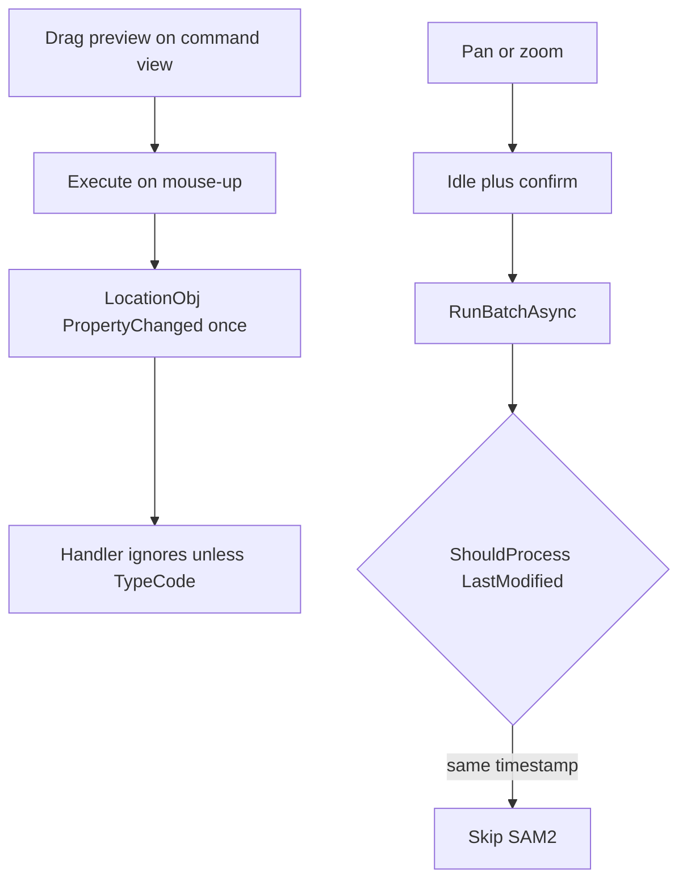
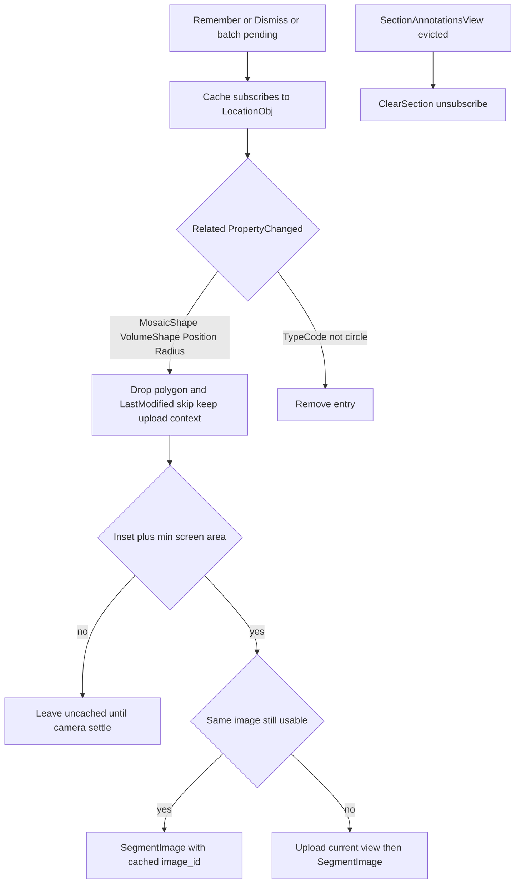

# Auto-segmenter refresh on annotation translate

## Current behavior

**No.** Dragging or translating an annotation does not call the segmentation server.

[`AutoCirclePolygonizeController`](Clients/Viking/WebAnnotation/UI/AutoPolygonize/AutoCirclePolygonizeController.cs) only starts a batch after **camera/section settle** (500ms idle + 1000ms confirm). `OnProposedLocationChanged` ignores everything except `TypeCode`. Subscriptions exist only after a proposal is published.

Translate/scale/resize **do not mutate the location during the drag**. Preview lives on the command view. The store is written once in `Execute()` (mouse-up / pen leave):

- [`TranslateCircleLocationCommand.Execute`](Clients/Viking/WebAnnotation/UI/Commands/TranslateLocationCommand.cs) → `UpdateCircleLocationNoSaveCallback`
- [`ResizeCircleCommand.Execute`](Clients/Viking/WebAnnotation/UI/Commands/ResizeCircleCommand.cs) → radius callback
- [`TranslateScaleCommandBase.OnMouseUp`](Clients/Viking/WebAnnotation/UI/Commands/TranslateScaleCommandBase.cs) → `Execute()`

So `PropertyChanged` on `MosaicShape` / `VolumeShape` / `Position` / `Radius` fires **once per completed command**, not per mouse-move.

Two traps remain even with a one-shot handler:

- **Cache key is `LastModified`, and save does not refresh it.** Circle translate sets geometry then calls `SaveLocationsWithMessageBoxOnError()`. [`LocationStore.ProxyUpdate`](Clients/WebAnnotationModel/Store/LocationStore.cs) returns **`long[]` IDs only**. [`ProcessUpdateResults`](Clients/WebAnnotationModel/Store/StoreBaseWithIndexKey.cs) `InternalUpdate`s the **same local object from its own `GetData()`**. `LastModified` stays the pre-save value and does not raise `PropertyChanged`. [`ShouldProcess`](Clients/Viking/WebAnnotation/UI/AutoPolygonize/AutoPolygonizeSelection.cs) would skip unless the cache entry is removed.
- **Proposal overlay is a frozen world polygon.** After commit, the old outline would sit at the pre-drag position unless that cache entry is dropped.

`SegmentationRequestCoalescer` is for the interactive Segment command only. Do not reuse it here.

## Intended ownership

The cache is the membership owner. Do **not** sync subscriptions to “visible circles ∪ proposal IDs”.

- [`AutoPolygonizeCache`](Clients/Viking/WebAnnotation/UI/AutoPolygonize/AutoPolygonizeSelection.cs) is **section-keyed**. An entry exists after `RememberProposal`, `Dismiss`, or when a circle is accepted as a batch candidate (pending).
- Each entry stores the SAM2 **`image_id`**, **downsample**, uploaded **world bounds**, and pixel size used to produce that proposal (or the in-flight upload). Several circles from one batch share one id.
- While an ID is in the cache, the cache holds that `LocationObj` `PropertyChanged` handler (same instance-tracking as today's `SubscribeLocation` so a store `Replace` can retarget).
- `Remove` / `ClearSection` unsubscribe and release that entry's image lease. No leftover handlers after eviction.
- GPU textures stay on the controller (graphics thread). A geometry commit drops the frozen polygon and the `LastModified` skip but **keeps** the upload context so the single-ID refresh can reuse the server image.

First-time circles that are not yet cached still rely on camera settle. After they are cached (pending, proposal, or dismissed), a geometry commit is enough.

Camera/section settle is unchanged (still idle + confirm). This path does not restart those timers. Navigating away does **not** clear proposals; only dropping that section's [`SectionAnnotationsView`](Clients/Viking/WebAnnotation/View/SectionAnnotationsView.cs) does.

## Implementation

1. **Section-key the cache.** `RememberProposal` / `Dismiss` / `ShouldProcess` / `Remove` take section number. `ClearSection(section)` drops every entry and overlay for that Z. Existing tests in [`AutoCirclePolygonizeTests.cs`](Clients/Viking/WebAnnotationTests/Commands/AutoCirclePolygonizeTests.cs) get a section argument.

2. **Cache subscribes while cached.** Move `SubscribeLocation` / `UnsubscribeLocation` onto `AutoPolygonizeCache`. Related properties: `MosaicShape`, `VolumeShape`, `Position`, `Radius`, `TypeCode`, and empty/`null` names. On geometry: drop the frozen polygon and `LastModified` skip, **keep** `image_id` / downsample / uploaded bounds, then notify the controller with **that location ID only**. On `TypeCode != CIRCLE`: full remove (release lease). Keep the subscribed instance so teardown hits the object we attached to; on store `Replace`, resubscribe if the ID is still cached.

3. **Single-ID refresh, not a full `RunBatchAsync` sweep.** Geometry commit does not re-collect every eligible circle. After the drop:
   - Load the live `LocationObj` and run the same eligibility as [`CollectEligibleCircles`](Clients/Viking/WebAnnotation/UI/AutoPolygonize/AutoCirclePolygonizeController.cs): current section, still a circle, volume center inside the inset, min on-screen area.
   - **Out of view / ineligible:** full remove (release lease). A later camera settle can pick it up.
   - **In view:** force one `SegmentImage` for that ID. Bypass `ShouldProcess`. Do not cancel in-flight SegmentImage work for **other** circles. Ignore or generation-stamp an in-flight `ProcessResponse` for **this** ID so a stale polygon cannot `RememberProposal` after the translate.

4. **Reuse the uploaded SAM2 image when it is still valid.** Today [`FinishProcessBatchAsync`](Clients/Viking/WebAnnotation/UI/AutoPolygonize/AutoCirclePolygonizeController.cs) always `DeleteImage` after the batch, so a later translate can never reuse. Change that to a **refcount/lease** per `image_id`: batch hold + one hold per cache entry that recorded that id. Delete only when the last hold is released (`ClearSection`, `Stop`, `TypeCode` forget, or last entry that used it is removed without reuse).
   - Reuse when the cached `image_id` is set, the live downsample has **not** changed by a factor of 2 or more (`live >= 2 * cached || live <= cached / 2`, same rule as [`ShouldLoadAnnotationsForCameraChange`](Clients/Viking/WebAnnotation/UI/AnnotationOverlay.cs)), and the circle's volume center still lies inside the **uploaded** world bounds.
   - Otherwise capture/upload the **current** view (new id, new bounds, new downsample).
   - Prompt mapping must use the uploaded bounds and pixel size, not the live camera.
   - **Server purge already has a re-upload path.** Do not add a second one. Single-ID reuse must call [`SegmentAsync`](Clients/Viking/WebAnnotation/UI/Commands/Segmentation/SegmentationViewportSession.cs) after installing the cached `image_id` on the session. `SegmentAsync` treats `RpcException` `NotFound` as “image gone”: it clears the local id, `UploadCurrentImageAsync` (live capture), and retries `SegmentImage` once. After a successful call, copy `CurrentImageId` / bounds / downsample back onto the cache entry and replace the lease so later translates use the new id.
   - Recapture (2× zoom, left uploaded bounds, or NotFound) releases the old id if nothing else holds it.

5. **Clear on `SectionAnnotationsView` eviction.** [`SectionAnnotationsViewCacheEntry.Dispose`](Clients/Viking/WebAnnotation/Cache/SectionLocationViewModelCache.cs) is empty today. [`TimeQueueCache.RemoveEntry`](Clients/Common/DataStructures/TimeQueueCache.cs) calls `OnRemoveEntry` then `Dispose`. Override `OnRemoveEntry` or fire an evicted event; [`AnnotationOverlay`](Clients/Viking/WebAnnotation/UI/AnnotationOverlay.cs) forwards `ClearSection`, which unsubscribes and deletes remaining leased images for that Z. Eviction can run on a thread-pool cleaner — keep cache/proposal locks. `OnSectionChanged` on the controller stays as-is (cancel work, keep other sections).

6. **Tests:** same `LastModified` after skip-clear is processable; `ClearSection` does not touch other Z; subscribe on Remember / unsubscribe on Remove; geometry-property names drop the polygon; reuse when zoom and bounds match; recapture when zoom changes by ≥2× or the center left the uploaded rect; last lease release deletes.

## Out of scope

- Interactive [`SegmentationCommand`](Clients/Viking/WebAnnotation/UI/Commands/Segmentation/SegmentationCommand.cs) (already has its own viewport debounce).
- Re-segmenting an already-accepted **CURVEPOLYGON** after translate (auto-polygonize is circle-only).
- Extra idle/confirm delay on translate/scale/resize commit.
- Subscribing to visible circles that have never entered the cache (first look is still camera settle).
