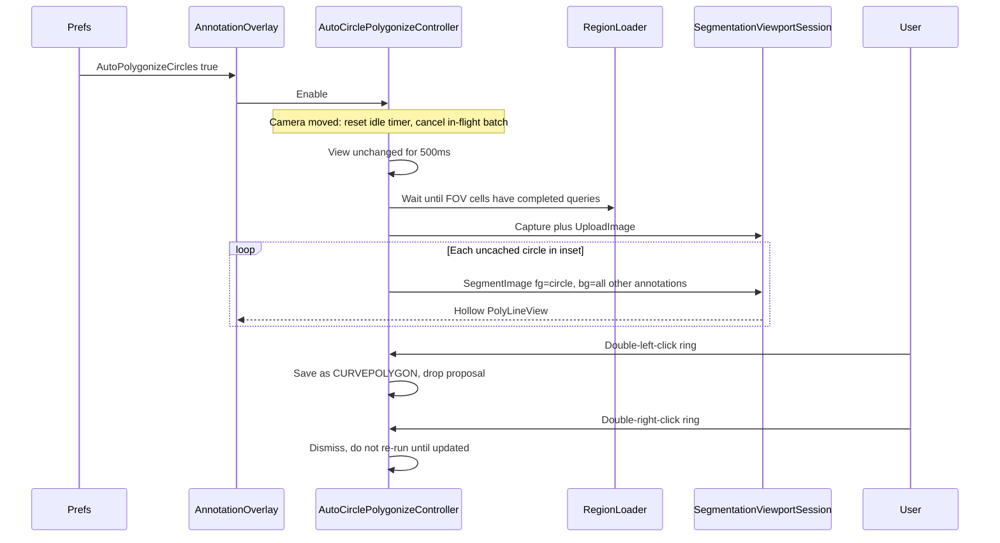

# Auto circle polygonize mode

## Behavior (defaults)

- **Off by default.** A checkbox in Annotation Preferences (Segmentation expander) is the persisted gate. If it is false, no timers, uploads, or overlays run. An Annotation menu checkable item will toggle the **same** setting so it can be flipped while working (same pattern as Pen Mode).
- **Circles only.** This is the batch equivalent of **Change Shape → Segment to Polygon...**. Existing polygons, curves, and lines are **negative markers only**.
- **Inset.** 20% margin on each edge of `VisibleWorldBounds` (inner 60%). A circle is a candidate if its **volume center** is inside that inset. Circles in the margin wait until the user pans/zooms them inward.
- **One upload, many `SegmentImage` calls.** Capture/upload the current view once (`showOverlays: false`, `asyncTextureLoad: false` — same as [SegmentationCommand.cs](Clients/Viking/WebAnnotation/UI/Commands/Segmentation/SegmentationCommand.cs)). Then, for each eligible circle, send that circle’s 17 foreground points and representative points from **all other current-section annotations in the uploaded view** as background (label 0). Results appear as they return.
- **Not a command.** This does **not** set `CurrentCommand`. The user keeps panning, tracing, and using interactive Segment to Polygon. While `SegmentationCommand` is active, auto-mode **pauses** new uploads/requests so the two do not fight over the cached image id.
- **Cache.** Keep proposal polylines in world space after the view moves. Skip a location if we already have a proposal whose `LastModified` matches. Re-run only when the location’s `LastModified` (or `TypeCode`) changes. Dismissed IDs are skipped until they are updated. Clear proposals when the mode is turned off.
- **Accept / dismiss.** Double-left-click near a proposal ring (screen-space tolerance, ~10 px, including holes) applies the same `CURVEPOLYGON` save as `UpdateLocationShapeFromVolumePolygon`. Double-right-click on a ring removes that proposal from the overlay and does **not** open the location context menu.

## Preference wiring

Follow existing annotation settings (not the YAML `[UserSetting]` skill).

- Add `AutoPolygonizeCircles` (`bool`, default `False`) on the hand-written partial [Settings.Segmentation.cs](Clients/Viking/WebAnnotation/Properties/Settings.Segmentation.cs) and in [Settings.settings](Clients/Viking/WebAnnotation/Properties/Settings.settings). Do not hand-edit generated `Settings.Designer.cs`.
- Expose `Global.AnnotationSettings.AutoPolygonizeCircles` in [Global.cs](Clients/Viking/WebAnnotation/Global.cs) (get/set + `Save()`, include in `ResetToDefaults`). Setter notifies the live overlay so enabling mid-session starts the idle watcher immediately.
- [AnnotationPreferencesDialog.xaml](Clients/WebAnnotationWPFControls/Forms/AnnotationPreferencesDialog.xaml): checkbox in the Segmentation expander, bound to the view-model.
- [AnnotationPreferencesDialogViewModel.cs](Clients/WebAnnotationWPFControls/Forms/AnnotationPreferencesDialogViewModel.cs): bool + original/load/apply/revert/reset (default false).
- [AnnotationMenu.cs](Clients/Viking/WebAnnotation/UI/AnnotationMenu.cs): pass through `LoadCurrentSettings` / `SaveSettingsFromViewModel`; add a checkable **Auto Polygonize Circles** item that writes the same property.

## Architecture

Keep interactive `SegmentationCommand` as-is for CapsLock / context-menu use. Extract the **non-UI** capture/upload/request/polygonize path so auto-mode does not copy Y-flip and PNG capture.

**New types (WebAnnotation):**

- `SegmentationViewportSession` — owns gRPC client, `CaptureViewportImage` / `UploadImage` / `DeleteImage`, world→viewport mapping with Y inversion, `SegmentImageAsync`, and `SegmentationMaskPolygonizer.CreatePolygons`. [SegmentationCommand](Clients/Viking/WebAnnotation/UI/Commands/Segmentation/SegmentationCommand.cs) will delegate upload/segment to this session (interactive points, hover fill, and mouse handling stay on the command).
- `CircleSegmentationPrompts` — the existing 17 mosaic points (center + 8 at `r/2` + 8 at `3r/4`) from `ContextMenu_SegmentCircleToPolygon`, plus background points via `AnnotationPointExtensions.GetAnnotationRepresentativePoints` for **all** other locations (not same-type-only).
- `LocationShapeUpdate.ApplyVolumePolygon` — shared save path currently private on [Location_ViewModelBase.cs](Clients/Viking/WebAnnotation/ViewModel/Location_ViewModelBase.cs) (`TypeCode = CURVEPOLYGON`, `SetShapeFromGeometryInVolume`, `Store.Locations.Save()`).
- `AutoCirclePolygonizeController` — idle debounce (reuse 500 ms + 1% bounds similarity from `SegmentationCommand`), wait for region loads, enqueue circles, cache, draw, accept/dismiss.
- `AutoPolygonizeProposal` — `LocationId`, `LastModified`, `GridPolygon`, `List<PolyLineView>` rings. Hit-test: `GridPolygon.Distance` vs a world length derived from downsample × 10 px.

**Idle + “annotations loaded”:**

There is no FOV-complete event today. Add `RegionLoader.AreRegionQueriesComplete(bounds, screenPixelSize, sectionNumber)` in [RegionLoader.cs](Clients/WebAnnotationModel/RegionLoader/RegionLoader.cs): every pyramid cell for that mosaic FOV has `LastQuery` and `AsyncResult is null` (in-flight is `AsyncResult != null`, which is already cleared in `OnLoadCompleted`). Do **not** rely on the existing `OutstandingQuery` getter (it is inverted relative to its comment).

Controller loop after camera `PropertyChanged`:

1. Cancel the in-flight batch and delete the uploaded image id (keep cached proposals).
2. After 500 ms with similar bounds, call the existing `RequestCurrentSectionAnnotationsLoad`.
3. Poll until `AreRegionQueriesComplete` or a short timeout (then proceed with local store contents).
4. If the view moved, abort and restart.
5. If `Parent.CurrentCommand` is `SegmentationCommand` or the flag is off or `!Global.IsSegmentationServiceAvailable`, do nothing.

**Draw / input:**

- [AnnotationOverlay.cs](Clients/Viking/WebAnnotation/UI/AnnotationOverlay.cs): construct the controller in `SetParent`; in `Draw`, after location backgrounds, draw proposal rings (`PolyLineView`, alpha ~0.65, width `max(1, Downsample * 2)` — same as `CreateRingView`).
- `ObjectAtPosition`: if a proposal ring is within the pixel threshold, return `AutoPolygonizeProposal` so it wins over the circle underneath for double-click only.
- Add `IHandleMouseDoubleClick` on [Interfaces.cs](Clients/Viking/NGVV/Common/Interfaces.cs). [DefaultCommand.cs](Clients/Viking/NGVV/UI/Command/DefaultCommand.cs) consults it **before** building the right/middle-button context menu, and also on left double-click. Return `true` to consume the event (prevents the empty/location context menu on dismiss).

Gate all of this on `IsCommandDefault()` for accept/dismiss so an in-progress place-curve command still owns double-click.

## Tests

Add [Clients/Viking/WebAnnotationTests/Commands/AutoCirclePolygonizeTests.cs](Clients/Viking/WebAnnotationTests/Commands/AutoCirclePolygonizeTests.cs):

- Inset rectangle (20% per edge).
- Eligibility: circle center inside inset vs in the margin; non-circles excluded.
- Cache skip unless `LastModified` changes; dismissed skip until update.
- Foreground point count/layout for a unit circle; background list excludes the target id.

Existing [SegmentationMaskPolygonizerTests.cs](Clients/Viking/WebAnnotationTests/Commands/SegmentationMaskPolygonizerTests.cs) stay as the mask→polygon contract.

## Changelog

Add a bullet under a new **1.2.62** section in [VikingChangelog.md](VikingChangelog.md).

## Out of scope

- `MultiSegmentImage` (one point per id; does not match Convert to Polygon’s 17-point prompts).
- Changing interactive Segment to Polygon accept (still click a green point inside the result).
- Waiting on an explicit “tiles finished” event beyond `RenderSceneToTexture(..., asyncTextureLoad: false)`, which already preloads before capture.
