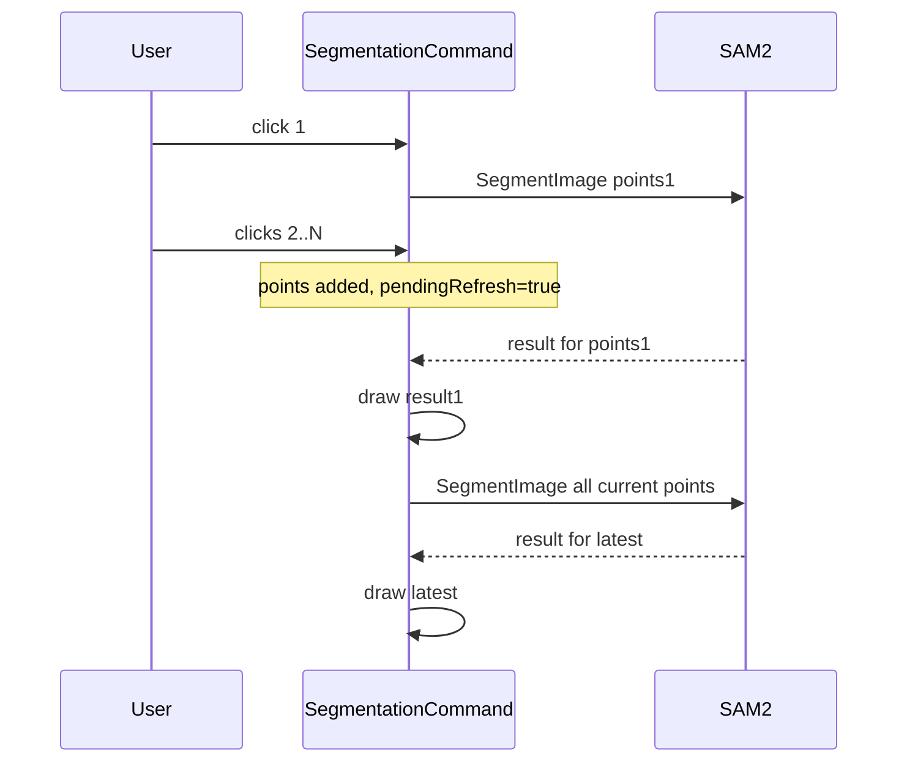

# Coalesce segmentation clicks to the latest prompts

Interactive [SegmentationCommand](Clients/Viking/WebAnnotation/UI/Commands/Segmentation/SegmentationCommand.cs) currently drops extra clicks while `isSegmenting` is true. After the in-flight unary `SegmentImage` returns, nothing retriggers, so a burst of clicks leaves dots on screen and a polygon from an older prompt set.

Keep one in-flight RPC (do not cancel, do not stream). Coalesce to a single follow-up with the live `foregroundPoints` / `backgroundPoints` lists.

## Behavior

- If `RequestSegmentation` is entered while a request is already running (or an upload is in progress), set `pendingRefresh = true` and return.
- When the in-flight `RequestSegmentation` finishes (success or failure), if `pendingRefresh` is still set, clear it and start **one** more `RequestSegmentation` on the UI dispatcher. That call reads the current point lists, so it includes every click placed during the wait.
- If more clicks arrive during the follow-up, they dirty the flag again and produce at most one extra RPC after that follow-up. Clicks never pile up into a queue of N requests.
- `RequestSegmentationOrClear` with zero foreground points clears results and **clears** `pendingRefresh` so a deleted-last-point does not fire a leftover segment.
- Viewport change (`CheckForViewportChange`) already cancels upload/render and deletes the cached image. Clear `pendingRefresh` there; the existing pan/zoom debounce still calls `RequestSegmentation` after settle.
- `OnDeactivate` / `CleanupCommand` clear the flag.

## Stale overlay race

`ProcessSegmentationResponse` is `BeginInvoke`d after `isSegmenting` is cleared. A later request can complete and draw, then the older `BeginInvoke` can overwrite it.

Give each `SegmentAsync` attempt a monotonically increasing `requestGeneration`. Capture the generation before the await. In `ProcessSegmentationResponse`, ignore the response if `generation < appliedGeneration`. This is required once follow-up requests exist.

Snapshot the prompt lists (or counts plus a generation) when building the request only for the generation check; the follow-up still uses the live lists so it always sends “all current points.”

## Where to change

All logic stays in [SegmentationCommand.cs](Clients/Viking/WebAnnotation/UI/Commands/Segmentation/SegmentationCommand.cs):

- Fields: `pendingRefresh`, `requestGeneration`, `appliedGeneration`.
- `RequestSegmentation`: dirty-and-return when busy; increment generation; after `finally`, if dirty, `BeginInvoke(RequestSegmentation)` on `MainThreadDispatcher`.
- `UploadImageAndRequestSegmentation`: the existing first-point `ContinueWith` still starts the first segment; extra clicks during upload set `pendingRefresh` via the `IsUploading` early-return path (change that path from silent return to dirty).
- `ProcessSegmentationResponse`: generation guard before replacing views.

No session or proto changes. Still one unary `SegmentImage` per attempt via [SegmentationViewportSession.SegmentAsync](Clients/Viking/WebAnnotation/UI/Commands/Segmentation/SegmentationViewportSession.cs).

## Tests

Existing [SegmentationCommandTests.cs](Clients/Viking/WebAnnotationTests/Commands/SegmentationCommandTests.cs) only duplicates helpers and cannot construct the command. Add a small internal/static helper (or extract a `SegmentationRequestCoalescer` with `TryStart` / `OnBusy` / `OnFinishedShouldRetry`) and unit-test:

- busy + another click → retry once after finish
- two clicks while busy → still one retry
- clear / cancel → no retry
- older generation is rejected when a newer one has been applied
