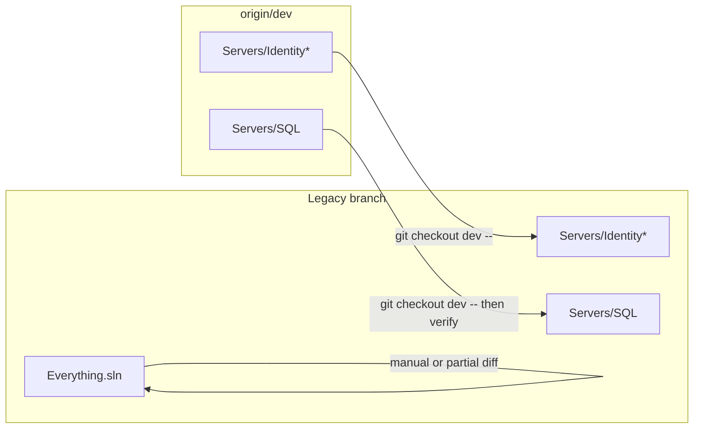

# Selective Identity + SQL from `dev` onto `Legacy`

## Context (verified)

- **[`D:\src\git\Viking`](D:\src\git\Viking)** and **[`D:\src\git\VikingLegacy`](D:\src\git\VikingLegacy)** are two clones of the same remote (`https://github.com/jamesra/Viking`). There is **no** branch named `VikingLegacy` on that remote; the long-lived line is **`Legacy`** (your Viking Legacy checkout uses it).
- **`origin/Legacy`** has **no** `Servers/IdentityServer` tree; **`origin/dev`** has **~440** tracked files there, plus **`Servers/Identity.DataContext`**, **`Servers/Identity.Models`**, **`Servers/Identity.Tests`**.
- **`Servers/SQL`**: Legacy has **183** paths, dev **192** — branches have **diverged** (commits on Legacy not in dev and vice versa). A blind `checkout dev -- Servers/SQL` can **drop Legacy-only scripts** unless you verify afterward.
- A **full** `git merge origin/dev` into `Legacy` touches **~2218 files** ([`Everything.sln`](Everything.sln) alone is **~574 insertions / 301 deletions** vs Legacy). You chose **selective** integration; that is the right call unless you intend to align the entire repos.



## Recommended Git workflow (selective)

Work in **one** clone you will push from (e.g. [`D:\src\git\VikingLegacy`](D:\src\git\VikingLegacy) on `Legacy`).

1. **`git fetch origin`** and ensure you are on **`Legacy`** (or a topic branch off `Legacy` for the PR).
2. **Bring trees from `dev` in one or two commits:**
   ```text
   git checkout origin/dev -- Servers/IdentityServer Servers/Identity.DataContext Servers/Identity.Models Servers/Identity.Tests
   git checkout origin/dev -- Servers/SQL
   ```
3. **Review SQL for lost Legacy-only files** (important):
   - After step 2, compare: `git diff origin/Legacy -- Servers/SQL` (or list files present on `origin/Legacy` but missing locally).
   - For anything that should remain Legacy-specific, **restore** with `git checkout origin/Legacy -- Servers/SQL/path/to/file.sql` and resolve overlaps manually if both sides edited the same procedure.
4. **Wire the build:**
   - **`Everything.sln`**: On `dev`, Identity appears as at least **`Servers\IdentityServer\IdentityServer\IdentityServer.csproj`**. On **`origin/Legacy`**, a search shows **no** Identity entries. Do **not** replace the whole `.sln` with `dev`’s (huge churn). Instead, **copy only the Identity-related `Project(...)` blocks** (and any needed **solution folder** / nesting GUID lines) from `origin/dev`’s [`Everything.sln`](Everything.sln) into your Legacy `.sln`, then open in VS and fix load errors.
   - **[`Directory.Build.props`](Directory.Build.props)**: `dev` vs `Legacy` differs (including deletions on `dev`). After adding projects, **build** and align shared MSBuild props only as needed (SDK versions, nullable, shared package versions)—prefer minimal edits over wholesale replacement.
5. **Optional related paths** (only if builds or Docker docs require them): e.g. any **`.dockerignore`**, **compose** files, or **IdentityServer**-specific docs you rely on—take them explicitly with `git checkout origin/dev -- <path>` rather than merging all of `dev`.
6. **Stop using symlinks / junctions** to [`D:\src\git\Viking`](D:\src\git\Viking): delete the link(s), ensure the real trees live under the **VikingLegacy** working tree, then **`git add`** and commit. Confirm nothing sensitive (e.g. `.env`, log folders under `Servers/IdentityServer/logs`) is tracked; use **`.gitignore`** and templates (your `dev` tree already includes examples like `secrets.json.example`).
7. **Build and smoke-test**: build the new projects, run your existing Identity Docker/dev scripts (`restart_omni.cmd` or equivalent from `dev` history), and hit the management site / token flows.

## Why not cherry-pick?

Identity work on `dev` is **many commits** interleaved with SQL, segmentation, Docker, and other server changes. Cherry-picking a subset is **high-conflict and error-prone**. **`git checkout origin/dev -- <paths>`** gives you the **current known-good trees** for those paths in one step; history stays linear on `Legacy` via your new commit(s).

## Risks to watch

- **Runtime coupling**: If something on `Legacy` (e.g. [`Servers/AnnotationService`](Servers/AnnotationService) token/JWT handling) expects **older** behavior, you may need **additional selective** files from `dev` after the first build/integration test—not a full merge, just the failing projects.
- **Protos / clients**: If Identity or gRPC contracts changed on `dev`, you may need matching updates under [`gRPC_Protos`](gRPC_Protos) or client code; that will surface as build or protocol errors.

## Deliverable

A **`Legacy` branch commit (or PR)** that contains **real checked-in** `Servers/Identity*` + updated **`Servers/SQL`**, updated **solution/build** glue, **no symlinks** to the other clone, and a short note in the commit message listing paths taken from `dev` and any **restored Legacy-only SQL** files.
