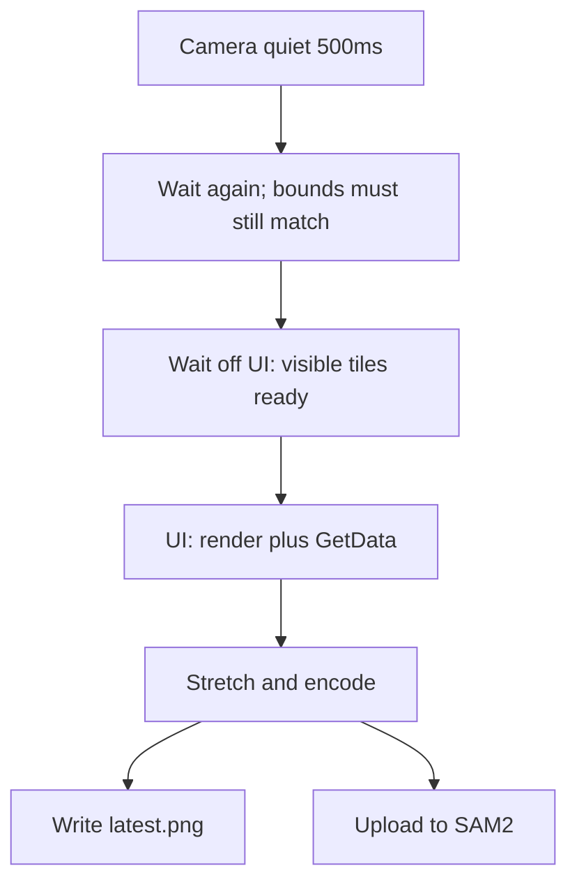

# Guarantee segmentation screenshots have tiles

A black TEM region means the offscreen draw ran on a `Clear(..., Color.Black)` target before visible tiles had a usable `Texture2D`. Current “success” is only “PNG decodes and size matches.” `latest.png` is overwritten on the next encode, which is why the bad frame disappeared.

Two concrete holes in the current path:

- `[GetOrLoadTextureAsync](Clients/Viking/NGVV/ViewModels/TileView.cs)` returns **null immediately** if the tile is already in `TextureRequestQueue` / `PendingTextureQueue`. After a section change the viewer has already queued loads; `[PreloadSceneTexturesAsync](Clients/Viking/NGVV/UI/Controls/SectionViewerControl.cs)` then “completes” without waiting, and `[RenderSceneToTexture](Clients/Viking/NGVV/UI/Controls/SectionViewerControl.cs)` draws empty tiles.
- GPU capture runs inside a Normal-priority `Dispatcher.InvokeAsync` (`[ReadViewportPixelsCoreAsync](Clients/Viking/WebAnnotation/UI/Commands/Segmentation/SegmentationViewportSession.cs)`). Texture GPU upload is pumped at `DispatcherPriority.Background` (`[PendingTextureQueue.PostPump](Clients/Viking/NGVV/Threading/PendingTextureQueue.cs)`), so it may not run until that capture op finishes.

`SceneHasTextures` only asks whether any visible tile *keys* exist. Do not add a black-pixel / luma coverage gate; wait until tiles are actually ready, then capture.

## 1. Wait for tiles before GPU capture

In `[SegmentationViewportSession](Clients/Viking/WebAnnotation/UI/Commands/Segmentation/SegmentationViewportSession.cs)`, **before** `InvokeAsync` render/readback:

- Ask the viewer for visible tiles at the current downsample (reuse the same mapping/channel loop as `QueueTextureLoadsForSectionAsync`).
- Ready means each tile `HasTexture` or `ServerTextureNotFound`.
- If not ready, kick loads and **await the existing in-flight work** (do not treat “already pending” as done). Poll/wait with the upload cancellation token and a timeout (about 10s, same idea as annotation wait).
- Do this **off** the UI dispatcher so `PendingTextureQueue` can pump. Only then marshal render + `GetData`.

Minimal viewer API, e.g. `Task<bool> WaitForVisibleTexturesAsync(Scene, z, token)` on `[SectionViewerControl](Clients/Viking/NGVV/UI/Controls/SectionViewerControl.cs)`, so capture does not duplicate tile enumeration.

If the wait times out, **do not capture or upload**. Log and return; the next idle can try again.

## 2. Do not treat a hitch as a settled camera

Uploaded frames showing pan/zoom are not a tile-ready problem. `[AutoCirclePolygonizeController](Clients/Viking/WebAnnotation/UI/AutoPolygonize/AutoCirclePolygonizeController.cs)` uses `System.Timers.Timer` at `IdleDebounceMs = 500`. That clock keeps running while the UI is busy. A processing hitch longer than 500ms fires `OnIdleElapsed` even though the user is still navigating; `BeginInvoke` then captures whatever the camera is doing when the UI catches up.

Waiting for tiles does **not** fix this.

- Keep the 500ms timer only as “maybe quiet.”
- When it fires on the UI thread, snapshot `VisibleWorldBounds` + downsample. **Do not capture yet.**
- Start a second confirm delay (1s). Any `OnCameraChanged` / section change cancels it.
- When confirm elapses, capture only if bounds and downsample still match the snapshot (`AreViewportBoundsSimilar` plus downsample equality).
- If they differ, restart the 500ms idle (user is still moving).

Optionally record `lastCameraChangeUtc` on the UI thread and, at both idle and confirm dispatch, abort if a camera event is newer than the armed snapshot. That covers a hitch that queued the timer callback before the next pan event was processed.

Do not start encode/upload until this confirm passes. Tile wait (section 1) stays a separate completeness check after the camera is actually still.

## 2b. Do not leave cancelled uploads on the server

In `[UploadCurrentImageAsync](Clients/Viking/WebAnnotation/UI/Commands/Segmentation/SegmentationViewportSession.cs)`, `currentImageId` is set only after `await UploadImageAsync`. Cancel during/after that RPC still creates the image on the server, then `ClearImageId()` drops the id so `DeleteCurrentImageAsync` cannot run (ID=8 in the 16.01.30 run).

- If the upload response arrives, always record the id before honoring cancel, then `DeleteCurrentImageAsync`.
- If the RPC is cancelled after the server assigned an id, try to read the id from the completed call so the cache entry cannot sit forever.

## 2c. Publish only for the live view

In `[ProcessResponse](Clients/Viking/WebAnnotation/UI/AutoPolygonize/AutoCirclePolygonizeController.cs)`:

- Before `RememberProposal` / `PublishProposal`, require `ShouldUploadEncodedCapture(session.ViewportBounds, liveBounds)` (read live bounds on the UI thread).
- If the camera/section moved, drop the polygon and **do not** cache the location, so the settled view can retry.

## 2d. Bound huge-mask polygonize

A wash / near-full-frame mask (ID=7: 6.06M of ~7.2M pixels) costs a minute and is not a useful circle proposal.

- If foreground fraction exceeds a high threshold (e.g. 40% of the mask), skip polygonize and log `skip huge mask`.
- Optionally downsample the mask before marching squares when width*height is large.

## 2e. Debug preference: overlay returned masks

Default-off checkbox in Annotation Preferences (same Segmentation expander as auto-polygonize). Label it as debug-only and not for everyday use.

Reuse the existing DEBUG path in `[SegmentationCommand.CreateDebugMaskOverlay](Clients/Viking/WebAnnotation/UI/Commands/Segmentation/SegmentationCommand.cs)`: decode the best-score PNG, `Texture2D` of non-zero pixels, `TextureOverlayView` in world bounds via `ViewportToWorld` (including the Y flip).

Setting (same pattern as `AutoPolygonizeCircles`):

- `AutoPolygonizeOverlayMasks` bool, default **false**, in `[Settings.Segmentation.cs](Clients/Viking/WebAnnotation/Properties/Settings.Segmentation.cs)` + `[Settings.settings](Clients/Viking/WebAnnotation/Properties/Settings.settings)`
- `[Global.AnnotationSettings](Clients/Viking/WebAnnotation/Global.cs)` getter/setter + `ResetToDefaults`
- `[AnnotationPreferencesDialog.xaml](Clients/WebAnnotationWPFControls/Forms/AnnotationPreferencesDialog.xaml)` checkbox after “Auto polygonize circles in view”
- Wire load/apply/cancel/reset in the dialog VM and `[AnnotationMenu](Clients/Viking/WebAnnotation/UI/AnnotationMenu.cs)`

Copy:

- Checkbox: `Overlay returned masks (debug)`
- Help: `Shows the raw SAM2 mask under each auto-polygonize outline so you can compare the service response to the traced polygon. Uses extra GPU memory; leave off during normal tracing.`

Runtime:

- When the flag is **off**, do not keep mask bytes or create textures.
- When **on**, `ProcessResponse` keeps decoded mask + segment world bounds on the proposal. Create `Texture2D` / `TextureOverlayView` on the UI thread in `PublishProposal` (GPU objects must not be created on `Task.Run`).
- `AutoPolygonizeProposal.Draw` draws the overlay first, then the existing rings, using the proposal color at low alpha.
- Dispose the texture on accept / dismiss / remove / `Stop`.
- Toggling off: stop drawing and dispose overlays. Toggling on does not backfill existing proposals; the next batch will include masks. Invalidate so the change is visible.

Do not lift `SegmentationCommand`’s `#if DEBUG` overlay into Release for the interactive command; this flag is only for auto-polygonize.

## 4. Debug disk captures

`[SaveCaptureForReview](Clients/Viking/WebAnnotation/UI/Commands/Segmentation/SegmentationCaptureEncoder.cs)` already overwrites `segmentation_capture_latest.png` after a successful encode. Keep that. All capture-saving-to-disk stays DEBUG-only; delete files older than 24 hours. Do not write a separate “rejected because black” file.

## 5. Retry

If the tile wait times out, skip capture and upload. Camera idle already starts a new batch. Do not scan the bitmap for black as a substitute for waiting.

