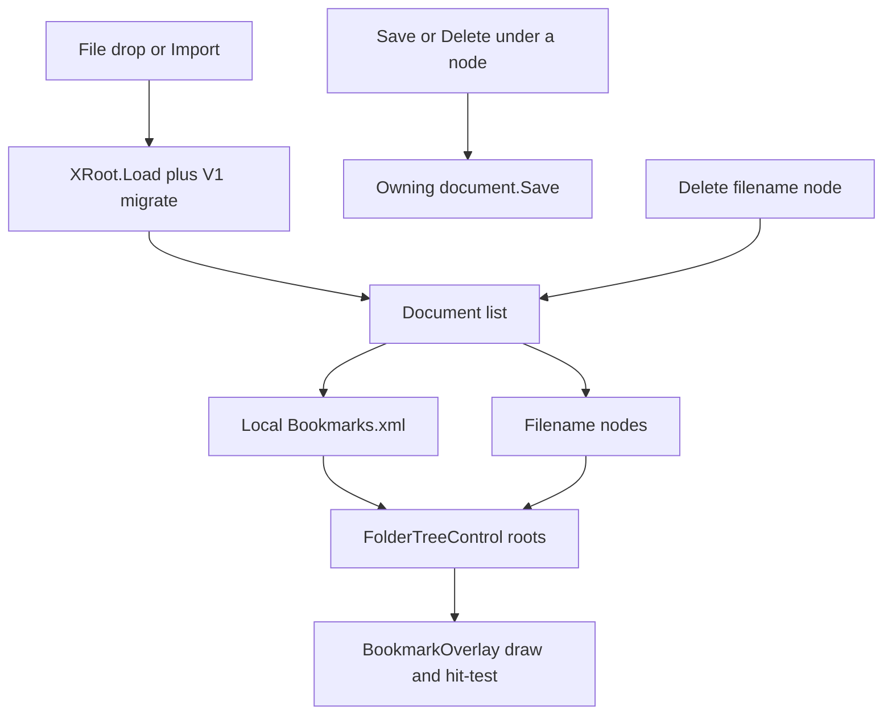

# Multi-file bookmark documents

## Why drag-drop is dead

The Bookmarks tab already advertises file drop (`AllowDrop = true` on [FolderTreeControl.cs](Clients/Viking/LocalBookmarks/FolderTreeControl.cs)). It never loads a file for two independent reasons:

1. **Wrong `FileDrop` payload.** Explorer supplies `DataFormats.FileDrop` as `string[]`. The drop handler asks for `typeof(string)`:

```311:315:Clients/Viking/LocalBookmarks/FolderTreeControl.cs
                string[] formats = e.Data.GetFormats();
                string filename = e.Data.GetData(typeof(string)) as string;

                Global.FolderUIObjRoot.ChildChanged -= OnRootChildChanged;
                Global.Load(filename);
```

`filename` is always `null`. `File.Exists(null)` is false, so [Global.Load](Clients/Viking/LocalBookmarks/Global.cs) returns without replacing anything (or, worse, can fall through to the undo file).

2. **The drop never reaches that handler.** The visible surface is `Tree` ([ObjectTreeView](Clients/Viking/NGVV/UI/Controls/ObjectTreeView.cs)), which has `AllowDrop = true`. Its `OnDragOver` sets `Effect = None` and returns when `UI.State.DragDropObject` is null (file drops). Its `OnDragDrop` returns immediately in the same case. Parent `OnDragDrop` only fires if the drop hits chrome around the tree, not the tree itself.

A third existing bug on the same path: folder-level import in [FolderUIObj.OnImportXML](Clients/Viking/LocalBookmarks/FolderUIObj.cs) merges children, then `this.Data.Save(fileDialog.FileName)` **writes the destination folder back over the source file**. Root Import uses `Global.Load`, which **replaces** the in-memory local document (and the next `Save()` would overwrite `Bookmarks.xml`).

Yes, drag-drop can be fixed. It should add a file as a new top-level document, not replace Local.

## Target tree

```
Local                  ← always first; volume-cache Bookmarks.xml; not deletable
  Folder A
  Bookmark …
colleague.xml          ← live document; Delete unloads from the session (does not delete the file)
  …
D:\share\notes.xml
```

- **Local** is the user’s volume-cache file (`…/Bookmarks/Bookmarks.xml`). Display name is always `Local`.
- Extra roots use the filename (tooltip = full path). Same basename from different folders stay distinct via tooltip; if two nodes would look identical, disambiguate the label with a parent folder.
- New bookmarks / folders go under the selected folder, or **Local** if nothing is selected. Viewer “Add Bookmark” stays on Local unless a folder under another file is selected.
- Edits under a filename node **save back to that path** (confirmed).
- Delete on a filename node **unloads** it from the session. Local has no Delete (and `Delete()` is a no-op if somehow invoked).
- Internal drag of a bookmark/folder between documents is a move: remove from source XML, add to dest XML, save **both** files.

## Architecture

Today everything is one static `XRoot` / `FolderUIObjRoot`. The tree hides that root and shows only its children ([SetRootFolder](Clients/Viking/LocalBookmarks/FolderTreeControl.cs)). Overlay draw/hit-test walks that single root ([BookmarkOverlay.cs](Clients/Viking/LocalBookmarks/BookmarkOverlay.cs)). Every `Save()` writes Local.

Introduce a small session list in `Global` (or a new `BookmarkDocumentStore`):

- `BookmarkDocument`: path, `XRoot`, visible `FolderUIObj` root, `IsLocal`.
- `Documents`: Local always at index 0; extras after.
- `Save(document)` writes that document’s path only. `UIObjTemplate.Save` / `FolderUIObj.Delete` resolve the owning document by walking `Parent` to the file root (not `Global.Save()` unconditionally).
- `LoadDocument(path)` parses with existing `XRoot.Load` + V1 migrate; skip if already loaded; append a file root whose **children** are that XML root folder’s folders/bookmarks (do not show an extra `"root"` level).
- Persist extras in a sidecar next to Local, e.g. `Bookmarks/LoadedFiles.txt` (one full path per line). On `Initialize`, load Local first, then extras that still exist. Do not put Local in the sidecar.

Do not edit generated [BookmarkSchemaV2.cs](Clients/Viking/LocalBookmarks/BookmarkSchemaV2.cs).



## Implementation steps

1. **File-drop plumbing (ObjectTreeView + FolderTreeControl)**  
   Add a virtual hook on [ObjectTreeView](Clients/Viking/NGVV/UI/Controls/ObjectTreeView.cs) (e.g. `TryHandleExternalDrop`) so `FileDrop` is not zeroed. FolderTreeControl implements it: `GetData(DataFormats.FileDrop)` as `string[]`, accept `.xml`, call `LoadDocument` per path. Keep existing IUIObject move behavior for in-tree drags.

2. **Document list + per-file save**  
   Replace single `BookmarkXMLDoc` / `FolderUIObjRoot` as the only store. Keep `FolderUIObjRoot` as a synonym for Local’s folder so existing “create under Local” call sites stay simple. `Parent = null` on an item still means Local, not “no document.” File roots are not valid `SetParent` targets for other file roots (cannot nest Local under `colleague.xml`).

3. **Tree UI**  
   `SetRootFolder` becomes “show all document roots as top-level nodes.” Subscribe to each root’s `ChildChanged`. File-root context menu: Export, Import (adds another sibling document), no Delete on Local; Delete on extras unloads. Empty-area Import/drop adds a document. Folder-level Import **merges into that folder** and saves the **owning** document — stop writing `this.Data.Save(sourcePath)`.

4. **Overlay + volume transform**  
   Draw / `ObjectAtPosition` / `RecursivelyUpdateVolumePositions` iterate every document root.

5. **Session restore**  
   Write/read the sidecar when extras are added or unloaded. Undo stays Local-only (existing `BookmarksUndo01.xml`).

6. **Tests**  
   No LocalBookmarks test project today. Add focused tests (new project or under an existing client test assembly) for: `FileDrop` → `string[]` helper; load two documents without replacing Local; unload extra does not delete the file; `Save` under extra does not rewrite Local; Local cannot be removed from the list.

## Out of scope

- Rank 9 (Hide Bookmarks) and rank 34 (Initialize swallows errors), unless they fall out of the same `Global` edits.
- Deleting extra files from disk.
- Cross-session undo for extra files.
- Geometry.
