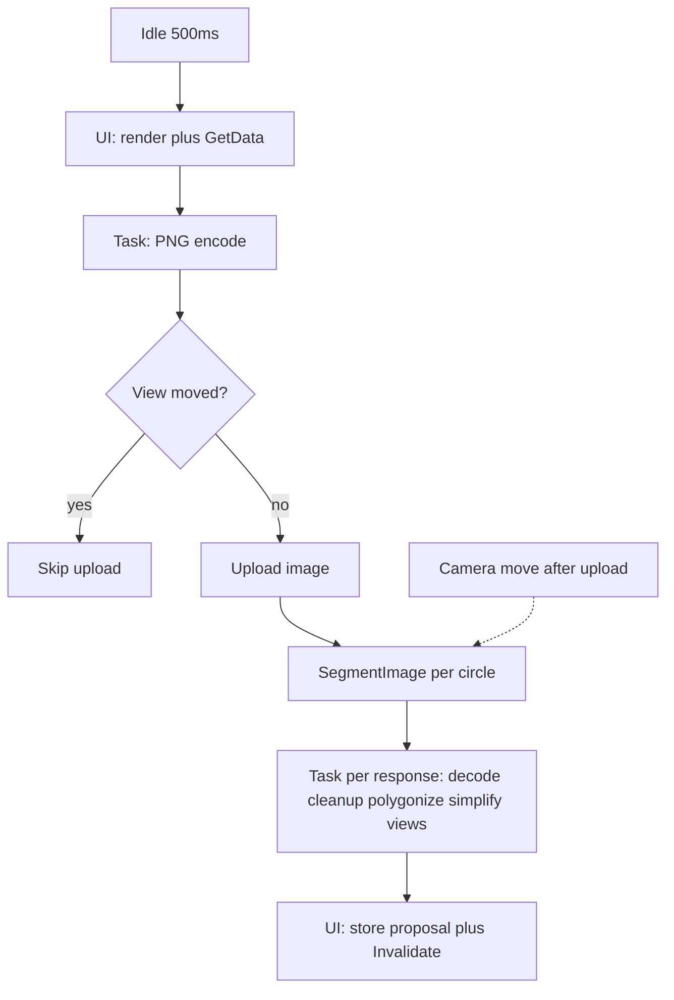

# Offload auto-segmentation CPU work

Auto-segmentation freezes after section/camera changes because [`RunBatchAsync`](Clients/Viking/WebAnnotation/UI/AutoPolygonize/AutoCirclePolygonizeController.cs) is posted to the UI dispatcher and uses `ConfigureAwait(true)`. After each SAM2 call it runs `CreatePolygonsFromResponse`, simplify, and `CreateRingViews` on the UI thread (logs show 11–15s). Camera/section changes also cancel the whole batch, including work after a successful upload.

## Cancellation policy

Split the current single `batchCts` / `CancelBatchKeepProposals()` into two phases:

- **Pre-upload** (capture + encode): cancel on camera move, section change, disable, or dispose. Do not call `UploadImage`.
- **Post-upload** (SegmentImage + per-response CPU): camera move does **not** cancel. Section change, disable, dispose, or a new `SegmentationCommand` still cancel.

After upload, snapshot the uploaded `imageId`, `ViewportBounds`, section number, downsample, and candidate list. Those SegmentImage calls use that snapshot even if the user pans.

`OnCameraChanged` still restarts the idle timer so a **new** capture can start for the new view. Do not tear down a batch that has already uploaded. Track the post-upload session separately and `DeleteCurrentImageAsync` only after its response tasks finish.

Section change still cancels both phases (wrong Z).

## Capture and upload: [`SegmentationViewportSession.cs`](Clients/Viking/WebAnnotation/UI/Commands/Segmentation/SegmentationViewportSession.cs)

Split `CaptureViewportImage` so GPU work and CPU work are explicit:

1. On the UI dispatcher: `RenderViewportToTexture` + `renderTarget.GetData` (already via `InvokeAsync`).
2. On a background task: `EncodeToPng` and `ValidateCapturedImage`.
3. After encode, compare the bounds captured in step 1 to `GetCurrentViewportBounds()` using `AreViewportBoundsSimilar`. If they differ, skip `UploadImage` and log the skip.

`UploadCurrentImageAsync` stays the shared entry point (auto-seg and `SegmentationCommand` both use it). Interactive segment-to-polygon then also avoids uploading a stale encode.

Keep existing `[SegmentationProfile]` lines; add a distinct log when encode is discarded because the view moved.

## Auto batch: [`AutoCirclePolygonizeController.cs`](Clients/Viking/WebAnnotation/UI/AutoPolygonize/AutoCirclePolygonizeController.cs)

- Collect candidates and do GPU capture on the UI thread, then `ConfigureAwait(false)` for the rest of the batch.
- After a successful upload, loop candidates and `await SegmentAsync` (SAM2 is ~100ms). Do **not** `ConfigureAwait(true)`.
- For each non-null response, start a **separate** `Task` that:
  - calls `CreatePolygonsFromResponse`
  - `SimplifyProposal`
  - `CreateRingViews` (CPU only; `CurveView` construction does not need the graphics device)
  - then `BeginInvoke` to insert the proposal under `proposalLock` and `Invalidate`
- Do not await each process task before starting the next SegmentImage. `Task.WhenAll` the process tasks before deleting the uploaded image.
- `parent.Invalidate()` must only run on the UI thread.

`Stop()` / section change must cancel outstanding process tasks and still avoid `Invalidate` on a disposing parent.

## Tests

Add focused tests in [`AutoCirclePolygonizeTests.cs`](Clients/Viking/WebAnnotationTests/Commands/AutoCirclePolygonizeTests.cs) for the new skip-upload helper (bounds changed after encode vs similar bounds). Existing eligibility/simplify tests stay as-is.

## Out of scope

Leave `SegmentationCommand.ProcessSegmentationResponse` on the UI thread unless the shared session split already helps its capture path. The reported freeze is the auto-polygonize batch after section swaps.
