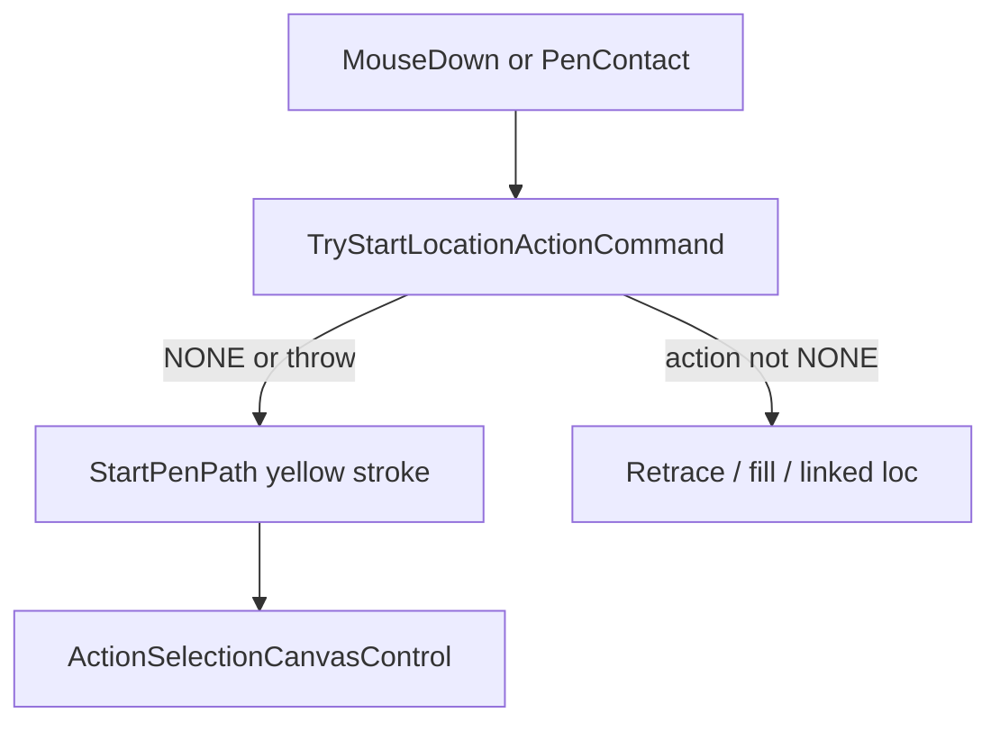

# Pen-mode UI regressions

Recent overlay dispatch ([LocationActionDispatch.cs](Clients/Viking/WebAnnotation/UI/LocationActionDispatch.cs), [AnnotationOverlay.cs](Clients/Viking/WebAnnotation/UI/AnnotationOverlay.cs) mouse-before-stroke) was meant to restore fill-bucket and other location actions in Pen Mode. It also made unimplemented pen methods and polygon `CHANGEBOUNDARY` run on every hover/click.



## Bugs to fix

**1. Closed-curve (and similar) crash — high**

[LocationClosedCurveView.cs](Clients/Viking/WebAnnotation/View/LocationClosedCurveView.cs) throws `NotImplementedException` from both `GetPenContactActionForPositionOnAnnotation` and `GetPenActionsForShapeAnnotation`. Dispatch and `UpdatePenCursor` have no try/catch (Legacy [AnnotationOverlay OnPenContact](d:/src/git/VikingLegacy/Clients/Viking/WebAnnotation/UI/AnnotationOverlay.cs) swallowed this). Hover, tap, or a stroke that touches a closed curve can crash; stroke completion never reaches the confirmation ring (`OnPenPathComplete` → `OnInteractionAdded` → `GetPenActionsForShapeAnnotation`).

Same throw pattern: [LocationLineView.cs](Clients/Viking/WebAnnotation/View/LocationLineView.cs) (one subclass), [OverlappedLocationView.cs](Clients/Viking/WebAnnotation/View/OverlappedLocationView.cs) `GetPenActionsForShapeAnnotation`.

**Fix:** Treat unimplemented as `NONE` / empty action list, never throw. Closed curves should return `NONE` on unmodified contact (so free-draw starts) and, on stroke complete, offer contour-replace + link actions the way [LocationOpenCurveView](Clients/Viking/WebAnnotation/View/LocationOpenCurveView.cs) / polygons already do via `Shared2DShapeActionsForPath`. Catch in `LocationActionDispatch.TryGetAction` as a backstop (log, return false).

**2. Unmodified Pen Mode click on a polygon starts retrace — high**

Mouse-down now calls `TryStartLocationActionCommand` before `StartPenPath`. With `Global.PenMode`, polygons use `GetMouseClickActionForPositionOnAnnotationWithPen`, which returns `CHANGEBOUNDARY` for any unmodified hit with **no** `Covers` / hole check:

```560:563:Clients/Viking/WebAnnotation/View/LocationPolygonView.cs
            else if (!ModifierKeys.ShiftOrCtrlPressed())
            {
                return LocationAction.CHANGEBOUNDARY;
            }
```

Legacy Pen Mode mouse skipped hit actions and started the yellow path. Retrace is supposed to be path-then-confirm, not tap-to-`RetraceAndReplacePathCommand`.

**Fix:** Unmodified WithPen contact returns `NONE` so free-draw runs. Keep Ctrl (cut/fill) and Shift (translate/link). Hardware pen uses the same `WithPen` method — same rule.

**3. Circles / polylines steal the stroke — medium**

[LocationCircleView](Clients/Viking/WebAnnotation/View/LocationCircleView.cs) pen contact always returns `CREATELINKEDLOCATION`. [LocationLineView](Clients/Viking/WebAnnotation/View/LocationLineView.cs) (~107) does the same unless Shift. After dispatch-first, a tap on a circle/line in Pen Mode starts linked-location instead of a path.

**Fix:** Unmodified pen contact on those types returns `NONE`; keep mouse (non-PenMode) behavior. Modifier + pen can still start those actions if they already did.

**4. Dispatch crash surface — medium (with 1)**

`TryGetAction` must not require `LocationCanvasView` (hole fill depends on that). It must also not let `NotImplementedException` escape. Hole views already return `NONE` without Ctrl — leave that.

Out of scope unless it shows up in the same pass: hardware pen still starts free-draw when Pen Mode is off (`OnPenContact` `Global.PenMode` check is commented in both trees); barrel cancel still keys off `e.Barrel` on move.

## Tests

Add to [WebAnnotationTests](Clients/Viking/WebAnnotationTests):

- Closed curve / overlapped location: contact and `GetPenActionsForShapeAnnotation` do not throw; unmodified contact is `NONE`.
- Polygon WithPen: unmodified → `NONE`; Ctrl on ring → `CUTHOLE`; Ctrl in hole → `REMOVEHOLE` (existing hole-fill tests stay).
- `LocationActionDispatch.TryGetAction` on a throwing stub returns false (no throw).
- If cheap: mouse-down order documented by dispatch returning false so overlay would call `StartPenPath` (unit-level on views/dispatch, not overlay WinForms).

## Files

- [LocationActionDispatch.cs](Clients/Viking/WebAnnotation/UI/LocationActionDispatch.cs) — catch + false
- [LocationPolygonView.cs](Clients/Viking/WebAnnotation/View/LocationPolygonView.cs) — WithPen unmodified `NONE`
- [LocationClosedCurveView.cs](Clients/Viking/WebAnnotation/View/LocationClosedCurveView.cs) — real pen methods, no throw
- [LocationCircleView.cs](Clients/Viking/WebAnnotation/View/LocationCircleView.cs) / [LocationLineView.cs](Clients/Viking/WebAnnotation/View/LocationLineView.cs) / [OverlappedLocationView.cs](Clients/Viking/WebAnnotation/View/OverlappedLocationView.cs) — unmodified contact `NONE`; actions list empty not throw
- New tests next to [PolygonHoleFillTests.cs](Clients/Viking/WebAnnotationTests/Commands/PolygonHoleFillTests.cs)
