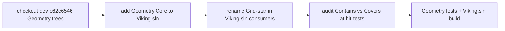

# Pull Geometry from `dev` without losing Legacy fixes

## Why

`dev` Geometry is a rename (`GridPolygon` → `Polygon`, `GridVector2` → `Vector2`, …) plus `Geometry.Core`, OGC `Contains`/`Covers`/`GetRelation`, and **symmetric polygon `Intersects`** (both `this.Covers(other[0])` and `other.Covers(this[0])`). That is the containment case that leaves three C606 siblings ungrouped on Legacy.

Do **not** merge the whole `dev` branch into `Legacy`. A previous full merge already went wrong (`6cbfedf5` / `fd7a4a3c`). Path-checkout the Geometry family only.

## Source

Use the local `dev` worktree at [D:/src/git/VikingLegacy](D:/src/git/VikingLegacy), **HEAD `e62c6546`** (`Port Legacy marching squares and ribbon tangents into Geometry.Core.`). Path-checkout from that commit.

`e62c6546` also touched `Clients/MonogameXNAGraphicsShared/RoundCurve.cs` and Bifrost `RoundCurve.cs`. **Do not** checkout those files; update Legacy `RoundCurve` during the consumer compile-fix so it calls `Vector2.CalculateRibbonTangents`.

Checkout these trees onto `Legacy`:

- `Geometry.Core/` (new; `netstandard2.0;net9.0`, namespace `Geometry`, assembly `Geometry.Core`)
- `Geometry/`
- `GeometryTests/`
- `SqlGeometryUtils/`, `SqlGeometryUtilsTest/`
- `TriangleNetGeometryExtensions/`
- `GeometrySqlTypeMapper/`, `GeometryOGCMapperTest/`
- `SqlGeometryAnnotationExtensions/` (already `Vector2`/`Polygon` on `dev`)

Do **not** checkout `Annotation.Geometry/` or `Viking.Annotation.Geometry/` (new layers, not on the Viking.exe graph). Do **not** checkout WebAnnotation, VolumeModel, or XNAGraphics from `dev` — those would overwrite Legacy auto-polygonize and the maintenance-review client fixes. Do **not** checkout `Utils`, `RTree`, or `GraphLib` — `dev` is ahead there and Legacy has no unique fixes.

## Legacy Geometry vs `dev` — already present, do not re-port

The four Legacy commits that touched Geometry (`2e5d138e`, `789b2f3f`, `03154886`, `34acb32b`) are accounted for. **Nothing else from Legacy Geometry or its compile dependencies is missing on `dev` HEAD.**

On **`dev` @ `e62c6546`:**

- Symmetric `Polygon.Intersects` / `GetRelation` / `ShapeRelation`
- `TransformFactory` NaN stos skip + `fileparts[3]` `FormatException`
- `MeshEdgeMap` and the `789b2f3f` / `9d5ee378` readonly-struct mesh/transform opts
- `Geometry.Core/Algorithms/MarchingSquares.cs` + `MarchingSquaresTests`
- `Vector2.CalculateRibbonTangents` / `UnwrapAngle` / `UnwrapAndLimitTangents`
- CurveFitting + `RibbonTangentSpec` tests; `CurveExtensions` `EnsureClosedRing` when `NumInterpolations == 0`

Still **dirty on the `dev` worktree** (not in `e62c6546`; path-checkout will not take them unless committed): `LineSegment` undirected hash, `TransformSerialization` BinaryFormatter `.NET 9` catch, `SqlGeometryUtils` managed centroid / envelope fallback, a few test/hash comment edits. Optional follow-up on `dev`; not required for this pull.

**Dependencies — no Legacy-only checkins to bring:**

| Tree | Verdict |
|------|---------|
| `SqlGeometryUtils` / tests / `SqlGeometryAnnotationExtensions` / `TriangleNetGeometryExtensions` / OGC mapper | Take committed `dev` (rename). Dirty SqlGeometry fallbacks stay on `dev` unless committed. |
| `RTree`, `GraphLib`, `Utils`, `UnitsAndScale` | **Do not checkout.** `dev` is ahead (nullable, `Utils.IO.LoadAsync` + `ConfigureAwait`). Legacy has no unique fixes there. Geometry.csproj on `dev` already dropped `Common` and `UnitsAndScale`. |

Cosmetic `03154886` warning cleanups (dead `return false`, unused locals) are obsolete on `dev`.

After checkout, only **confirm** MarchingSquares lives under `Geometry.Core/Algorithms` (same `Geometry` namespace) so [SegmentationMaskPolygonizer](Clients/Viking/WebAnnotation/UI/Commands/Segmentation/SegmentationMaskPolygonizer.cs) still resolves `MarchingSquares.FindContours`.

## Solution / deploy

- Add `Geometry.Core` to [Clients/Viking.sln](Clients/Viking.sln) (and [Everything.sln](Everything.sln) if we touch it). `dev` Viking.sln relies on the transitive ProjectReference only; listing it avoids a hidden DLL.
- [Geometry/Geometry.csproj](Geometry/Geometry.csproj) on `dev` already references `Geometry.Core` and dropped `Clients/Common` + `UnitsAndScale`. Keep that.
- Confirm `Geometry.Core.dll` lands next to `Geometry.dll` in the Viking output (SDK ProjectReference copy). No extra CopyModules rule unless the build proves it is missing.

## Consumer compile-fix (Viking.sln only)

`dev` has **no `Grid*` aliases**. After checkout, every Legacy `GridPolygon` / `GridVector2` / … site will fail. Update **Viking.sln** projects in place (keep Legacy behavior). Leave Jotunn / Bifrost / MonogameTestbed broken until a follow-up.

Rename map (same as `dev`):

- `GridPolygon` → `Polygon`, `GridVector2` → `Vector2`, `GridVector3` → `Vector3`, `GridRectangle` → `Rectangle`, `GridCircle` → `Circle`, `GridLineSegment` → `LineSegment`, `GridPolyline` → `Polyline`, `GridTriangle` → `Triangle`, `GridBox` → `Box`, `MappingGridVector2` → `MappingVector2`
- `.Convert()` → `ToPolygon()` / `ToCircle()` / `ToLineSegment()` / `ToRectangle()`
- `IRectangle` → `IRectangle2D`

**XNA clash:** `Geometry.Vector2` vs `Microsoft.Xna.Framework.Vector2`. Follow the `dev` pattern already in [D:/src/git/VikingLegacy/Clients/MonogameXNAGraphicsShared](D:/src/git/VikingLegacy/Clients/MonogameXNAGraphicsShared): `using Vector2 = Microsoft.Xna.Framework.Vector2;` and qualify `Geometry.Vector2` / `Geometry.Rectangle`. Use `dev` as a **rename reference only** — do not copy those files over Legacy graphics fixes (circle IB reset, alpha BasicEffect cache, etc.).

**`Contains` vs `Covers` (do not blind-rename):** On `dev`, `Contains(point)` is interior-only; **`Covers` includes the boundary**. Hit-tests that used Legacy `Contains` (boundary counted) must become `Covers`. Do not “finish” sibling grouping on `bool Intersects` — see the follow-up below.

## Verification

- After checkout: `Geometry.Core/Algorithms/MarchingSquares.cs` and `Vector2.CalculateRibbonTangents` exist on Legacy.
- `GeometryTests` (`net48`) including MarchingSquares tests, ribbon-tangent CurveFitting tests, and a both-ways “small polygon inside large” `Intersects` case (add if `dev` lacks it).
- `Clients/Viking.sln` Release build.
- WebAnnotationTests that construct polygons / auto-polygonize overlap (`OverlapChainIncludesTransitiveSiblings` plus a nested-containment case).

## After Geometry lands (do not forget)

Switch auto-polygonize sibling grouping from `current.Polygon.Intersects(other.Polygon)` in [AutoPolygonizeSelection.CollectOverlappingSameCellComponent](Clients/Viking/WebAnnotation/UI/AutoPolygonize/AutoPolygonizeSelection.cs) to **`GetRelation` / `ShapeRelation`**.

`ShapeRelation` is a `[Flags]` enum in [Geometry.Core/Primitives/Interfaces.cs](D:/src/git/VikingLegacy/Geometry.Core/Primitives/Interfaces.cs): `None`, `Contained`, `Touching`, `Intersecting`. `Contains` / `Covers` / `Intersects` are wrappers over it. Grouping should decide from the relation (for example merge on `Contained` or `Intersecting`, maybe skip bare `Touching`), not from a boolean that collapses all of those.

This is **not** part of the Geometry checkout. It is the next change once Viking compiles against the new types. Do not treat a successful `Intersects` compile-fix as done for the three-C606 process case.

Also still separate: `MaxOverlapResubmitRound`.

## Out of scope for this Geometry pull

- Merging `dev` WebAnnotation (would drop sibling-merge / prompt work on Legacy).
- Jotunn, Bifrost, MonogameTestbed, MorphologyMesh until a later pass.
- Changing auto-polygonize `MaxOverlapResubmitRound`.
- Implementing the `ShapeRelation` grouping change (follow-up above).
