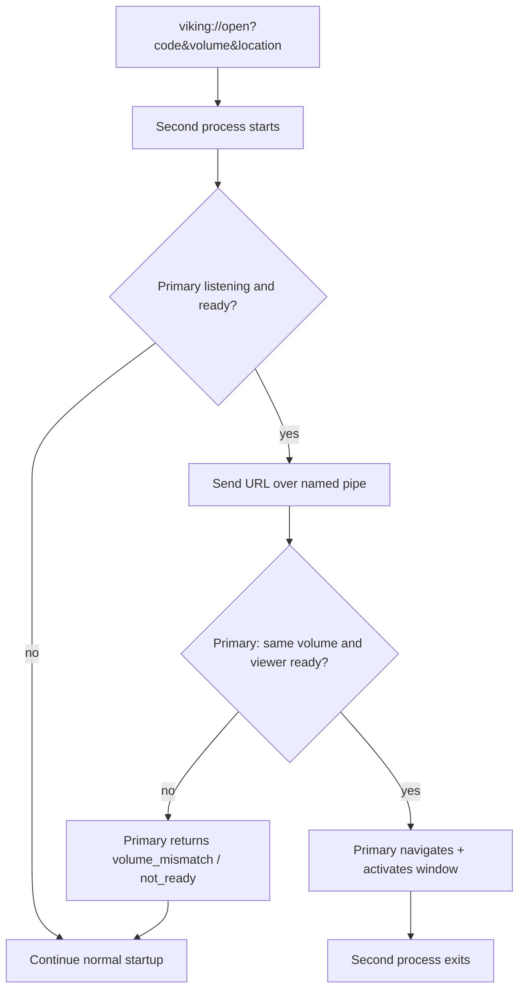

# Reuse running Viking for same-volume deep links

## Behavior

Defaults (from your request):
- **Same volume + viewer ready** → reuse instance, goto place, bring to foreground, second process exits.
- **Different volume, or primary still on login/splash** → second process continues as a normal new Viking (current behavior).

## IPC approach (net48 / STA)

Add [`Clients/Viking/Viking/VikingSingleInstance.cs`](Clients/Viking/Viking/VikingSingleInstance.cs):

- Global mutex name e.g. `Local\VikingLegacy.SingleInstance` (per-user; avoids admin/cross-session issues).
- Named pipe e.g. `VikingLegacy.Activation` for payload + short ACK.
- Protocol: second instance sends the raw `viking://…` string; primary replies `OK`, `VOLUME_MISMATCH`, or `NOT_READY`.
- Short connect/response timeout (~1–2s). On any failure, second instance falls through to normal startup (safe default).

Wire early in [`Program.Main`](Clients/Viking/Viking/Program.cs) **after** Velopack / settings upgrade, **before** splash/login:

1. If args contain `viking://…`, try `TryForwardToExistingInstance(url)`.
2. If ACK is `OK` → `return` (exit second process).
3. Otherwise acquire mutex + start pipe server listener on a background thread that marshals handling onto `State.MainThreadDispatcher` / WinForms UI thread once available.

Primary must register the handler once the volume is loaded and the main viewer exists (see below), so early deep links during login correctly get `NOT_READY` and open a new process.

## Same-volume detection

Compare the link’s `volume=` (endpoint URL on `viking://`) to the open volume URL:

- Persist the opened URL on [`UI.State`](Clients/Viking/NGVV/UI/State.cs) at login (e.g. `State.VolumeUrl`), normalized with existing [`Util.AppendDefaultVolumeFilenameIfMissing`](Clients/Viking/NGVV/Util/Util.cs) and trim/trailing-slash / ordinal-ignore-case compare.
- Also accept a match on `State.IdentityVolumeName` when the exchange (or link) provides a name and the open session has the same Identity name — useful if endpoint spelling differs slightly but Identity name matches after exchange.

Primary accepts only when:

- `State.volume` is non-null (volume loaded), and
- URLs/names match as above, and
- A viewer is available (`State.ViewerForm` / annotation overlay ready for Location ID).

## Navigation in the existing instance

Reuse existing startup place parsing from [`Program.ApplyStartupPlaceArguments`](Clients/Viking/Viking/Program.cs) (extract to a small shared helper if needed so pipe handler and startup share one parser).

Then on the UI thread:

- **Location ID** → call existing [`AnnotationOverlay.GoToLocation(long)`](Clients/Viking/WebAnnotation/UI/AnnotationOverlay.cs) (already static / AskServer-capable).
- **Coordinates** → `State.ViewerForm` / section viewer `GoToLocation(Vector2, Z)` + optional DS (same path as [`VikingMain`](Clients/Viking/NGVV/UI/Forms/VikingMain.cs)).

Activate the main window (`ViewerForm` / main form `BringToFront`, `Activate`, Win32 foreground helper if needed).

**Auth note:** For same-volume goto, do **not** re-run login or require a successful launch-exchange before navigating. Place args already ride on the `viking://` URL. Optionally still POST launch-exchange in the background only to consume the one-use code (or leave it to expire); do not block navigation on it.

## Docs

Update [`Documentation/source/server/Identity/sbfsem-viking-deeplinks.rst`](Documentation/source/server/Identity/sbfsem-viking-deeplinks.rst): remove/replace the “always new process” limitation with same-volume reuse + different-volume still new process.

## Out of scope

- Switching volumes inside the existing process.
- Single-instance for non-`viking://` launches (double-clicking the exe can still open two windows).
- Cross-user / service-session activation.
