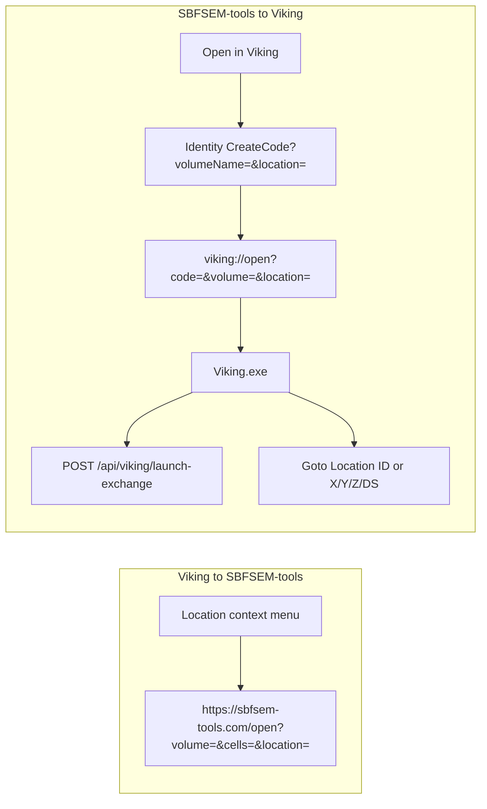

# SBFSEM-tools ↔ Viking deep links

SBFSEM-tools already supports opening a volume/cell/location from a browser URL. Viking on **Legacy** has no SBFSEM menu and no `viking://` handler. The Identity **dev** stack already mints `viking://open?code=&volume=` (volume endpoint only). **unify** already registers `viking://` and exchanges the launch code, but ignores a place in the volume.

This work stays on **Legacy**. Port the missing launch stack from `unify` / `origin/dev`, then add location and coordinates.

## Parameter contract (what we will tell SBFSEM-tools)

Keep names they proposed, and keep the existing `volume` URL param so current **Open in Viking** buttons keep working.

- `volumeName`: Identity resource name (`RC2`, `InferiorMonkey`, …). Required when SBFSEM-tools calls CreateCode. Volume is mandatory in both directions because IDs are per-volume.
- `volume`: existing CreateCode param; the volume **endpoint URL**. Still used by Identity’s own buttons.
- `location`: either a Location ID (`769111`) **or** a comma-separated `x,y,z[,downsample]` string from their pick readout.
- Optional explicit `x`, `y`, `z`, `ds` query keys (same keys Viking already reads in [`VikingMain.cs`](Clients/Viking/NGVV/UI/Forms/VikingMain.cs)). If both a Location ID and coordinates are present, **Location ID wins**.

Location and coordinates are not stored on `VikingLaunchCode`. They only ride on the `viking://` URL.

SBFSEM-tools’ outbound URL stays:

`https://identity.codepharm.net:4001/VikingLaunch/CreateCode?volumeName=RC2&location=769111`

---

## 1. Viking → SBFSEM-tools (client only)

Their `/open` API already works. Add a right-click item next to **Copy Location ID**.

**Volume name.** Use the Identity name, not VikingXML `volume.Name`. Persist `LoginWindow.VolumeName` (already Identity `VolumeInfo.Name`) onto `Viking.UI.State` at login in [`Program.cs`](Clients/Viking/Viking/Program.cs). Fallback: XML name if the user opened a URL without the Identity tree.

**Cell ID.** Walk `LocationObj.Parent` / `StructureObj.ParentID` until `ParentID` is null, using `Store.Structures.GetObjectByID(..., AskServer: true)` so a synapse still finds its cell. That is the `cells=` value; the right-clicked annotation is `location=`.

**Menu.** Add **Open in SBFSEM-tools** in [`Location_ContextMenuView.cs`](Clients/Viking/WebAnnotation/View/Location_ContextMenuView.cs) (and the same on [`Structure.cs`](Clients/Viking/WebAnnotation/ViewModel/Structure.cs) for a structure click). Hide the item if volume name or cell ID cannot be resolved. Open with `Process.Start(new ProcessStartInfo(url) { UseShellExecute = true })`.

**URL.** Default `https://sbfsem-tools.com/open?volume={identityName}&cells={cellId}&location={locationId}`. Add a user setting `SbfsemToolsOpenUrl` on Viking settings (default that URL) so a staging host can be swapped without a rebuild.

---

## 2. Identity: CreateCode accepts volume name + place

Legacy Identity does **not** have VikingLaunch. Production Identity (from `origin/dev`) does. Port onto Legacy, then extend:

- Model + migration: `VikingLaunchCode` / `AddVikingLaunchCodes` from `origin/dev`
- [`VikingLaunchController`](Servers/IdentityServer/Viking.Identity.Server.WebManagement/Controllers/VikingLaunchController.cs) on WebManagement
- WebApi `POST /api/viking/launch-exchange`
- `viking_user_token` grant: [`VikingUserTokenGrantValidator.cs`](Servers/IdentityServer/IdentityServerStandalone/VikingUserTokenGrantValidator.cs) + client store + `AddExtensionGrantValidator`

**CreateCode changes** (smallest additive API):

- Accept `volumeName`, `location`, `x`, `y`, `z`, `ds` in addition to existing `volume`.
- If `volumeName` is set, resolve `ApplicationDbContext.Volume` by `Name` (ordinal ignore-case) and use `Endpoint` as `VolumeUrl`. 404 if unknown.
- Keep writing only `Code` / `UserId` / `VolumeUrl` / expiry to the DB.
- Redirect to `viking://open?code=…&volume={endpoint}` and append `location` / `x` / `y` / `z` / `ds` when present.

Existing **Open in Viking** buttons that pass `asp-route-volume="@Model.Endpoint"` stay valid.

---

## 3. Desktop: consume `viking://` and go to the place

Port from **unify**, then add location/coords.

**Port as-is**

- [`VikingProtocolRegistration.cs`](Clients/Viking/Viking/VikingProtocolRegistration.cs) — HKCU `viking://` → `"Viking.exe" "%1"`
- `TryHandleVikingOpenUrl` + `ExchangeLaunchCodeAsync` + `ShowLoginWindowWithLaunchResult` in [`Program.cs`](Clients/Viking/Viking/Program.cs)
- `LoginWindow` properties unify already has: `InitialApiToken`, `InitialIdentityServerUrl`, `InitialVolumeUrl` (skip login when the code already produced a token; still let the user confirm volume/segmentation if needed)
- Setting `LaunchExchangeBaseUrl` (default `https://identity.codepharm.net:6001`)

**New:** parse `location` / `x`/`y`/`z`/`ds` from the protocol URL into `UI.State.StartupArguments` before the viewer starts.

- Integer `location` → `StartupArguments["Location"]`
- Comma form or explicit keys → `X`, `Y`, `Z`, `DS` (already consumed by [`VikingMain.cs`](Clients/Viking/NGVV/UI/Forms/VikingMain.cs) for camera position)

**Goto Location ID after annotations exist.** `GoToLocation(long)` in [`AnnotationOverlay.cs`](Clients/Viking/WebAnnotation/UI/AnnotationOverlay.cs) already loads from the server via `Store.Locations.GetObjectByID`. After overlay construction (`_CurrentOverlay = this`), if `StartupArguments["Location"]` is set, call `GoToLocation` (use `AskServer: true`). If the ID is missing in this volume, show a message that names the open volume — the RC2 vs InferiorMonkey failure mode.

Coordinates use the existing VikingMain path; Location ID is applied after the overlay exists so the annotation store is ready.

**First-pass limitation:** a `viking://` click starts a **new** Viking process (unify today). No single-instance forwarding. If Viking is already open, the user gets a second window. Call that out to SBFSEM-tools; single-instance IPC can be a follow-up.

---

## 4. Out of scope (from their report, not this feature)

Chrome “Dangerous site”, stale identity-session error page, rotating the `sbfsem-tools` client secret, `HumanAMD`, and `scopes_supported` omitting `openid`/`profile`. Those are Identity ops/hygiene, not this deep-link work.

---

## 5. What to send back to SBFSEM-tools

- `volumeName` and `location` are the names we will ship.
- `location` accepts a Location ID **or** `x,y,z[,downsample]`.
- CreateCode URL: `/VikingLaunch/CreateCode?volumeName={IdentityName}&location={id-or-coords}`.
- Viking’s outbound URL stays `/open?volume={IdentityName}&cells={rootStructureId}&location={locationId}`.
