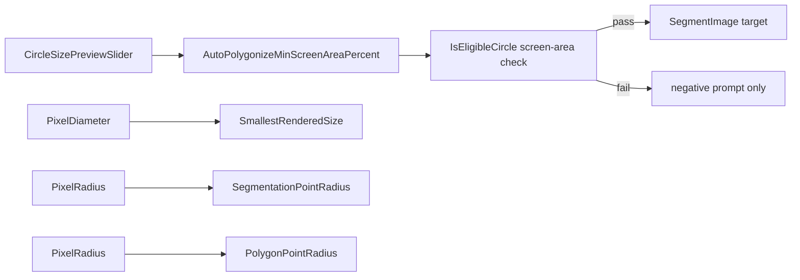

# Screen-area cutoff preferences

## Behavior

New setting **Auto polygonize min size** is a **percent of current viewport area** (not mosaic/world radius). Default **1.0%**, minimum **0.0%**, step **0.1%**. Circles whose on-screen area is below that cutoff are still used as negative/background prompts, but are not submitted as auto-polygonize targets.

Runtime check (screen pixels):

```
screenRadius = loc.Radius / scene.ScreenPixelSizeInVolume
screenArea   = π * screenRadius²
viewportArea = Viewport.Width * Viewport.Height
eligible if screenArea >= (percent / 100) * viewportArea
```

`0%` keeps today’s “any size” behavior. Volume/mosaic radius is the same number on `LocationCircleView` (center is transformed, radius is not), so `LocationObj.Radius` plus `ScreenPixelSizeInVolume` is the correct screen size.

Reuse the same control for every **screen-pixel size** preference. Drop the old hard maxes and let the slider max follow the preview circle’s page-width cap. Defaults and mins stay as they are. If a stored value is larger than the current page allows, the slider sits at max; the stored pixel value is still used at runtime. Raise or remove the matching `Global.AnnotationSettings` clamps so large values persist.

- **Smallest Rendered Size** — screen-pixel **diameter**. Min/default **0.5**. Remove the **10px** cap. Slider max = control `ActualWidth`. Preview diameter = `Value`.
- **Segmentation Point Radius** — screen-pixel **radius** (prompt dots). Min **1**, default **5**. Remove the **15px** cap. Slider max = `ActualWidth / 2` so a maxed preview circle still fits the page. Preview diameter = `2 * Value`.
- **Polygon Point Radius** — screen-pixel **radius** (polygon control points). Min **1**, default **6**. Remove the **50px** cap. Same radius preview and `ActualWidth / 2` max.

Leave **MinRadius** (world units), **Adjacent Section Radius** (multiplier), **Default Line Width** (world stroke), and opacity sliders on their existing controls.

## Shared WPF control

Add [`Clients/WebAnnotationWPFControls/Controls/CircleSizePreviewSlider.xaml`](Clients/WebAnnotationWPFControls/Controls/CircleSizePreviewSlider.xaml) (+ code-behind):

- Header, help text, slider, read-only value box
- `Value` / `Minimum` / `Maximum` / `TickFrequency`
- `PreviewMode`: `PercentOfScreen`, `PixelDiameter`, or `PixelRadius`
- Under the slider, a filled `Ellipse` whose diameter is:
  - **Percent mode:** `2 * sqrt((Value/100) * W * H / π)` where `W` is the control’s `ActualWidth` and `H` is a 16:9 stand-in (`W * 9/16`), so the page stands in for the screen
  - **PixelDiameter:** preview = `Value`; slider max = `ActualWidth`
  - **PixelRadius:** preview = `2 * Value`; slider max = `ActualWidth / 2`
- Cap diameter at the control’s `ActualWidth` (property-page width). Preview row height grows with the circle so a 1% default is visible (~tens of pixels on a 480px-wide page); `0%` / `0.5px` shows a degenerate or hairline circle
- Percent label uses `F1` plus `"% of screen"` (e.g. `1.0% of screen`)

Slider max for the new auto-polygonize setting: **10%** (circle already large; graphic still capped at page width). Min **0**.

## Wiring

- Setting: [`Settings.settings`](Clients/Viking/WebAnnotation/Properties/Settings.settings) + [`Settings.Segmentation.cs`](Clients/Viking/WebAnnotation/Properties/Settings.Segmentation.cs) as `AutoPolygonizeMinScreenAreaPercent` default `1.0`
- [`Global.AnnotationSettings`](Clients/Viking/WebAnnotation/Global.cs): clamp 0–10, save, include in `ResetToDefaults`
- Dialog VM + XAML: new percent control in the Segmentation expander (above the auto-polygonize checkbox). Replace the Smallest Rendered Size, Segmentation Point Radius, and Polygon Point Radius slider blocks with the same control (`PixelDiameter` / `PixelRadius`). Update help text that still cites 10 / 15 / 50 px ranges.
- [`AnnotationMenu.cs`](Clients/Viking/WebAnnotation/UI/AnnotationMenu.cs): load / apply / live `PropertyChanged` like the other segmentation prefs
- [`AutoPolygonizeSelection.IsEligibleCircle`](Clients/Viking/WebAnnotation/UI/AutoPolygonize/AutoPolygonizeSelection.cs): add screen-area parameters (keep inset-only overload so existing tests stay valid); add `MeetsMinScreenArea(...)`
- [`AutoCirclePolygonizeController.CollectEligibleCircles`](Clients/Viking/WebAnnotation/UI/AutoPolygonize/AutoCirclePolygonizeController.cs): pass viewport pixel size + current setting



## Tests

In [`AutoCirclePolygonizeTests.cs`](Clients/Viking/WebAnnotationTests/Commands/AutoCirclePolygonizeTests.cs):

- Circle at 1% of a known viewport is eligible; slightly under is not
- `0%` accepts any positive radius
- Existing inset tests keep using the overload without a size cutoff

Build Viking after the change. No changelog unless this repo’s release notes are already being updated in the same session for 1.2.62.

Do not change `MinRadius` (world-unit create/edit floor). It is a different setting.

No other persisted size settings are missing from the dialog (`PenMode`, favorites, and segmentation URL are not sizes). Hardcoded pixel constants (`HitTestPixels` 10, proposal line-width multiples, `searchRadiusSquared` 10px, mask simplification 2px) stay as constants; do not invent new preferences for them in this pass.
