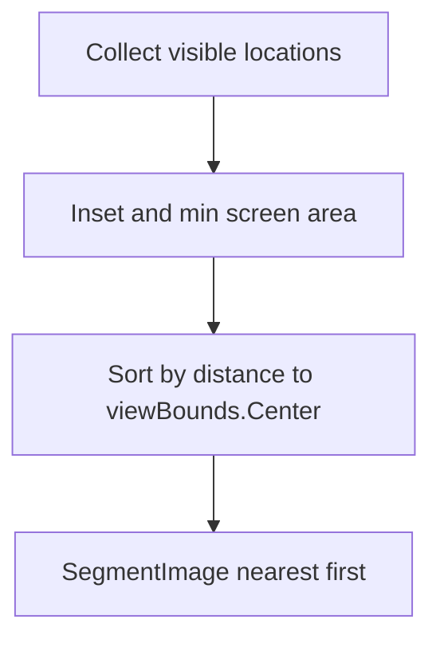

# Submit auto-segment circles nearest first

## Scope

Only the auto-polygonize **batch** path. [`RunBatchAsync`](Clients/Viking/WebAnnotation/UI/AutoPolygonize/AutoCirclePolygonizeController.cs) already uploads once, then `SegmentAsync` each candidate in [`CollectEligibleCircles`](Clients/Viking/WebAnnotation/UI/AutoPolygonize/AutoCirclePolygonizeController.cs) order. That list is currently whatever [`GetLocations`](Clients/Viking/WebAnnotation/View/SectionAnnotationsView.cs) returns (spatial-index order).

Interactive [`SegmentationCommand`](Clients/Viking/WebAnnotation/UI/Commands/Segmentation/SegmentationCommand.cs) is one user-prompted request. Single-ID translate refresh is already one circle. Neither needs a sort.

## Change

After the eligibility filter, sort by **squared distance** from `viewBounds.Center` (world/volume rectangle of the uploaded viewport) to each circle’s `VolumePosition` — the same point already used for inset eligibility.

Add a testable helper on [`AutoPolygonizeSelection`](Clients/Viking/WebAnnotation/UI/AutoPolygonize/AutoPolygonizeSelection.cs), e.g. `CompareDistanceFromCenter(GridVector2 a, GridVector2 b, GridVector2 center)`, and `OrderBy` in `CollectEligibleCircles`. Equal distance can stay stable (`OrderBy` is stable).

## Tests

In [`AutoCirclePolygonizeTests.cs`](Clients/Viking/WebAnnotationTests/Commands/AutoCirclePolygonizeTests.cs): given a view rectangle and three centers (on-center, near, far), the ordered list is nearest to farthest. A pair at equal distance keeps input order.
