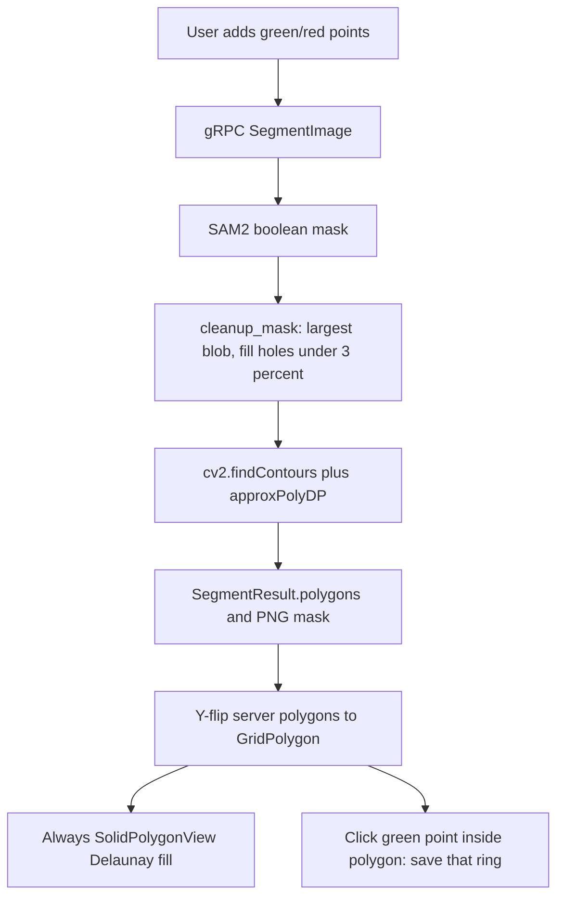
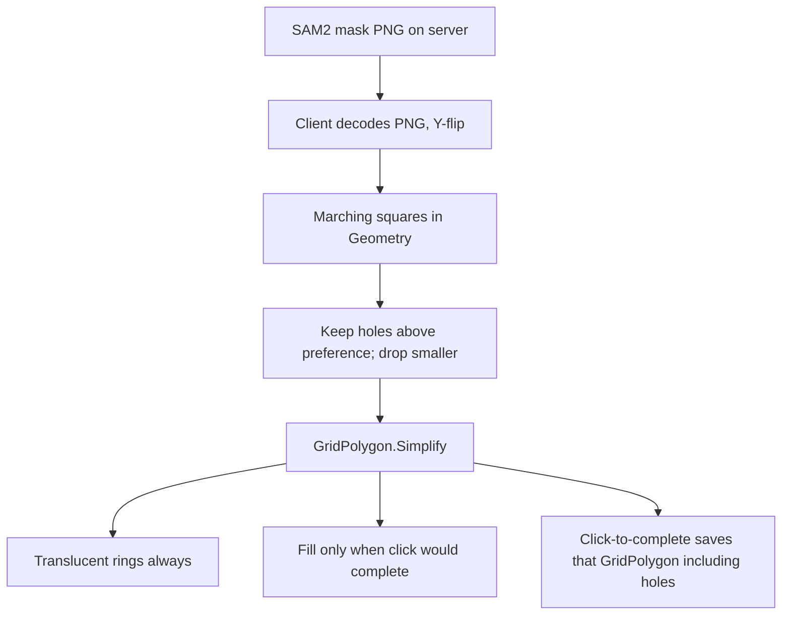

# Segmentation mask-to-polygon quality

## What happens now

Server polygons are the live source. The PNG mask is decoded only in DEBUG. Client [`MaskToPolygon`](Clients/Viking/WebAnnotation/UI/Commands/Segmentation/SegmentationCommand.cs) is unused. [`cleanup_mask`](Servers/SegmentationServer/segmentation_server/segmentation_server/segmentation_service.py) fills holes under a hardcoded 3% and [`mask_to_polygons`](Servers/SegmentationServer/segmentation_server/segmentation_server/segmentation_service.py) drops remaining holes via `RETR_EXTERNAL`.

Preview fill is a Delaunay mesh of the ring. Extra “concave triangles” are contour/simplification artifacts plus that mesh; they are not the saved vertex list. After save, [`LocationPolygonView`](Clients/Viking/WebAnnotation/View/LocationPolygonView.cs) draws a smoothed fill plus control points.

## Target pipeline

## 1. Preview: translucent rings, fill only when click would complete

In [`SegmentationCommand`](Clients/Viking/WebAnnotation/UI/Commands/Segmentation/SegmentationCommand.cs):

- Always draw each candidate’s **exterior ring and hole rings** with [`PolyLineView`](Clients/MonogameXNAGraphicsShared/Views/PolyLineView.cs). That is the geometry `success_callback` will receive.
- Show a translucent [`SolidPolygonView`](Clients/MonogameXNAGraphicsShared/Views/SolidPolygonView.cs) fill **only** when the mouse is in a complete-and-save pose: over a green foreground point **and** inside a candidate. That matches [`HandleForegroundPointAddition`](Clients/Viking/WebAnnotation/UI/Commands/Segmentation/SegmentationCommand.cs) (green point hit, then [`FindPolygonContainingPoint`](Clients/Viking/WebAnnotation/UI/Commands/Segmentation/SegmentationCommand.cs)).
- Track that hover polygon in existing [`OnMouseMove`](Clients/Viking/WebAnnotation/UI/Commands/Segmentation/SegmentationCommand.cs) (~468) and invalidate. Clear the fill when the mouse leaves that pose.
- Do not use the Delaunay fill as the only preview.

## 2. Client polygonization from the raw mask

**Source of truth:** the mask bytes already on [`SegmentResult.mask`](gRPC_Protos/Segmentation/SAM2/segmentation.proto). Lift PNG decode off `#if DEBUG` and build `GridPolygon`s from the mask, not from `segment.Polygons`.

**Marching squares on the client, not the server.** Viewport masks are typically on the order of the window (a few megapixels at most). That is O(width × height) and stays off the shared GPU/SAM2 box, so it stays cheap under multi-user load. Add a small marching-squares contour tracer in [`Geometry`](Geometry) (nothing exists today; do not revive nearest-neighbor `ExtractContourFromMask`).

**Holes:** marching squares yields multiple closed iso-contours. Classify by winding / containment. The outer ring is the exterior; interiors become [`GridPolygon.AddInteriorRing`](Geometry/Primitives/GridPolygon.cs). Drop a hole if its area is below the new preference (fraction of the parent segment area; default 0.03 to match today’s server).

**Simplify with Viking geometry**, not OpenCV `approxPolyDP`. After contour assembly, call [`GridPolygon.Simplify`](Geometry/CurveFitting/CatmullRom.cs) (and/or [`DouglasPeuckerReduction`](Geometry/CurveFitting/CurveExtensions.cs)) with a pixel-scaled tolerance, same family as pen simplify. Reuse; do not add a second algorithm.

**Non-simple repair only if needed.** [`GridPolygon`](Geometry/Primitives/GridPolygon.cs) construction already throws on an invalid/duplicate ring; that is why [`ConvertProtoPolygonToGridPolygon`](Clients/Viking/WebAnnotation/UI/Commands/Segmentation/SegmentationCommand.cs) swallows `ArgumentException` and skips candidates. After simplify, if construction fails or the ring self-intersects, run a minimal make-valid (e.g. existing self-intersection helpers / drop the offending vertices) and keep the result. Do not repair rings that already construct cleanly.

Replace the dead `MaskToPolygon` path with this pipeline. Add a Geometry/WebAnnotation unit test: a C-shaped mask must keep the bay; a 1-pixel spike should vanish after simplify; a hole above/below the threshold is kept/dropped.

## 3. Hole-drop preference

Follow the existing `SegmentationPointRadius` pattern (not YAML `[UserSetting]`):

- [`Settings.settings`](Clients/Viking/WebAnnotation/Properties/Settings.settings): `SegmentationHoleDropFraction` (double, default `0.03`)
- [`Global.AnnotationSettings`](Clients/Viking/WebAnnotation/Global.cs): clamped getter/setter + `ResetToDefaults`
- [`AnnotationPreferencesDialog.xaml`](Clients/WebAnnotationWPFControls/Forms/AnnotationPreferencesDialog.xaml) Segmentation expander: slider next to point radius, labeled as percent of segment area
- Wire through [`AnnotationPreferencesDialogViewModel`](Clients/WebAnnotationWPFControls/Forms/AnnotationPreferencesDialogViewModel.cs) and [`AnnotationMenu`](Clients/Viking/WebAnnotation/UI/AnnotationMenu.cs) load/apply/reset

Client hole dropping reads this setting. Server must not fill holes with a hardcoded 3% anymore.

## 4. Server: pass the raw mask

- Keep returning the SAM2 PNG mask (cropped bbox + `x`,`y` is fine).
- Stop using server polygons on the client. Skip [`mask_to_polygons`](Servers/SegmentationServer/segmentation_server/segmentation_server/segmentation_service.py) so the server does not spend OpenCV time on unused rings.
- Move hole filling off the server. `cleanup_mask` may still keep the largest connected component to suppress islands, but must **not** fill holes; that policy is now a client preference. If “raw” is taken strictly, skip CC cleanup too and let the client keep the largest blob after decode — prefer client-side largest-component so the mask on the wire matches SAM2.

Leave SAM2 `predict` and `MultimaskOutput = false` as-is. Proto can keep `polygons` unused for compatibility.

## Implementation order

1. Preference + settings plumbing (needed before hole logic).
2. Client mask decode + marching squares + simplify + holes; switch preview to rings / hover fill.
3. Stop server polygonize and server hole fill so the two sides do not fight.
