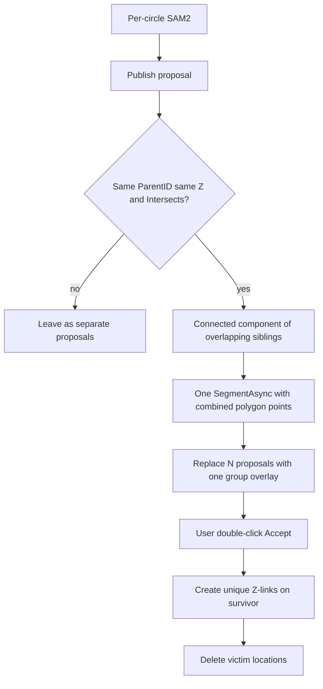

# Same-cell overlapping polygons: SAM2 resubmit

## Context

RC1 cells can have **multiple `LocationObj`s on one section** (same `ParentID`; no uniqueness on `(ParentID, Section)`). Auto-polygonize today submits **each circle alone** ([`AutoCirclePolygonizeController`](Clients/Viking/WebAnnotation/UI/AutoPolygonize/AutoCirclePolygonizeController.cs)), keeps `polygons.FirstOrDefault()`, and keys one [`AutoPolygonizeProposal`](Clients/Viking/WebAnnotation/UI/AutoPolygonize/AutoPolygonizeProposal.cs) per `LocationId`. Same-cell siblings are already excluded from background prompts so they do not cancel each other.

Those independent masks often overlap because they are one process. Location links are **same structure, different Z only** ([`LocationLinkView.IsValidLocationLinkTarget`](Clients/Viking/WebAnnotation/View/LocationLinkView.cs)); there is no location-merge API. Delete removes a location’s links on the server, so unique neighbors must be recreated on the survivor **before** delete.

You chose **option 2**: do not boolean-union the outlines. Resubmit one `SegmentImage` whose foreground is points from the overlapping polygons, and use that single mask.

Scope: **auto-polygonize** (this is what produces sibling proposals). Interactive [`SegmentationCommand`](Clients/Viking/WebAnnotation/UI/Commands/Segmentation/SegmentationCommand.cs) is unchanged unless you ask to reuse the same accept helper later.

Non-overlapping same-cell footprints (real branches) stay separate.

## Detect overlap

After [`ProcessResponse`](Clients/Viking/WebAnnotation/UI/AutoPolygonize/AutoCirclePolygonizeController.cs) publishes a proposal, on the UI thread:

- Collect other published proposals with the same `ParentID` and `SectionNumber`.
- Treat as overlapping when [`GridPolygon.Intersects`](Geometry/Primitives/GridPolygon.cs) is true (this includes containment). There is no union API; that is enough for grouping.
- Build the **connected component** (A overlaps B, B overlaps C → one group). Cap a follow-up: if the new mask later overlaps another same-cell proposal, expand the set and resubmit **once more**.

Helpers live in [`AutoPolygonizeSelection.cs`](Clients/Viking/WebAnnotation/UI/AutoPolygonize/AutoPolygonizeSelection.cs) so tests can cover Intersects grouping without the controller.

## Resubmit prompts

New helper next to [`CircleSegmentationPrompts`](Clients/Viking/WebAnnotation/UI/Commands/Segmentation/CircleSegmentationPrompts.cs) (or a method there):

- Foreground: for each polygon in the group, take the **centroid** (guaranteed interior if the ring is simple) plus a **subsampled exterior** (existing simplify / every Nth vertex so SAM2 is not flooded). Map to volume the same way as today.
- Background: visible annotations **except every involved location and any same `ParentID`**, then `ExceptNearForeground`.
- One `SegmentAsync` on the existing uploaded viewport session. Keep the highest-score polygon (`FirstOrDefault` after `CreatePolygonsFromResponse`).

Replace the N per-location proposals with **one group proposal**. Dictionary today is `proposals[locationId]`; store the same instance under **every involved ID** so hover/hit/dismiss still resolve.

[`AutoPolygonizeCache`](Clients/Viking/WebAnnotation/UI/AutoPolygonize/AutoPolygonizeCache.cs): `RememberProposal` / skip for all members so the idle batch does not re-fire them as independent circles.

## Accept: survivor, links, delete

Extend [`AutoPolygonizeProposal`](Clients/Viking/WebAnnotation/UI/AutoPolygonize/AutoPolygonizeProposal.cs) with `IReadOnlyList<long> LocationIds` (single-id groups stay a list of one). [`Accept`](Clients/Viking/WebAnnotation/UI/AutoPolygonize/AutoCirclePolygonizeController.cs) for a multi-id group:

1. **Survivor** = most `LinksCopy` neighbors, tie-break **lowest ID** (keeps the richer Z skeleton).
2. `LocationShapeUpdate.ApplyVolumePolygon(survivor, groupPolygon, parent)` — still circle → `CURVEPOLYGON`.
3. For each victim: for each `otherId` in `victim.LinksCopy`, skip self / other victims / already-linked; `Store.LocationLinks.CreateLink(survivorId, otherId)`. Same-Z survivor–victim links are invalid and must not be created.
4. `Store.Locations.Remove(victim)` then [`AnnotationOverlay.SaveLocationsWithMessageBoxOnError`](Clients/Viking/WebAnnotation/UI/AnnotationOverlay.cs). Server delete already strips leftover victim links.
5. Drop all group IDs from proposals + cache; invalidate.

Put transfer+delete in a small helper (e.g. `LocationSiblingMerge`) so Accept stays thin and tests do not need the graphics controller.

Dismiss of the group dismisses every member (same LastModified skip as today).

## Tests

In [`AutoCirclePolygonizeTests.cs`](Clients/Viking/WebAnnotationTests/Commands/AutoCirclePolygonizeTests.cs):

- Two intersecting same-`ParentID` polygons form one component; a third disjoint sibling is excluded.
- Different `ParentID` intersecting polygons are not grouped.
- Link transfer: victim-only neighbor is created on survivor; shared neighbor is not duplicated; same-Z ids are skipped.
- Prompt helper: centroid plus subsampled ring, empty/degenerate ring rejected.

## Out of scope

- Local boolean union (option 1).
- Changing SAM2 itself or allowing same-section location links.
- Interactive Segment-to-polygon multi-pick UI.
