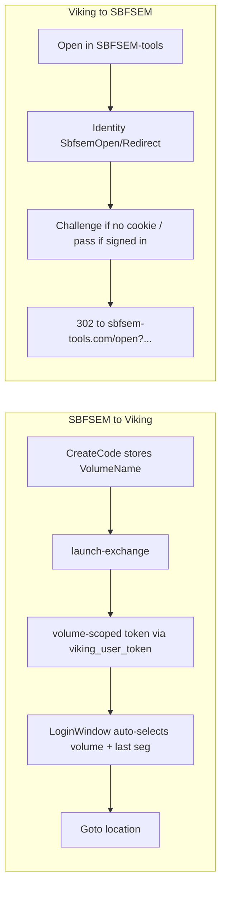

# Smooth SBFSEM ↔ Viking auth handoff

Defaults chosen for “both, starting with Web → Viking”:
- **SBFSEM → Viking**: auto-select volume from the link, reuse last segmentation service when known (otherwise skip), then jump to location — no password/volume/seg pickers in the happy path.
- **Viking → SBFSEM**: Identity-first browser bounce (no tokens in the URL). Establishes/reuses the Identity cookie so SBFSEM’s OIDC can SSO silently.

---

## Part 1 — SBFSEM → Viking (do first)

### 1a. Volume-scoped launch token

Today [`launch-exchange`](Servers/IdentityServer/Viking.Identity.Server.WebApi/Controllers/VikingLaunchController.cs) returns only an **api** token (`openid profile Viking.Annotation`). [`LoginWindow`](Clients/Viking.UI.WPF/LoginWindow.xaml.cs) then falls back to that token because there is no password for ROPC — AnnotationService may lack `RC2.Read` / `RC2.Annotate` scopes.

Changes:
- Add optional `VolumeName` on [`VikingLaunchCode`](Servers/Identity.Models/VikingLaunchCode.cs); set it in WebManagement [`CreateCode`](Servers/IdentityServer/Viking.Identity.Server.WebManagement/Controllers/VikingLaunchController.cs) when `volumeName` is resolved (or derive name from `Endpoint` match). Small migration.
- In `launch-exchange`, after claiming the code:
  1. Mint api token as today (needed for Identity API calls if any).
  2. Resolve volume name from `VolumeName` or by matching `VolumeUrl` to `Volume.Endpoint`.
  3. Load that user’s permissions via existing DB helper (`UserResourcePermissions` / same logic as [`PermissionsController.UserPermissions`](Servers/IdentityServer/Viking.Identity.Server.WebApi/Controllers/PermissionsController.cs)).
  4. Mint a **second** token with client `Viking`, grant `viking_user_token`, scopes `openid profile Viking.Annotation {Name}.Read …`.
  5. Return `access_token` = volume-scoped token (keep `api` token only if useful; otherwise just return the volume token as `access_token`).
- Allow `viking_user_token` on the **Viking** client in [`IdentityServerVikingClientStore`](Servers/IdentityServer/IdentityServerStandalone/IdentityServerVikingClientStore.cs) (today only `api` has it).
- Fix [`UserScopeTokenRequestValidator`](Servers/IdentityServer/Viking.Identity.Server.Extensions/UserScopeTokenRequestValidator.cs): when `ValidatedRequest.UserName` is empty (extension grant), resolve the user by **subject id** so volume scope checks work for `viking_user_token`.

### 1b. Auto-advance login UI

In [`LoginWindow`](Clients/Viking.UI.WPF/LoginWindow.xaml.cs) when `InitialApiToken` + `InitialVolumeUrl` are set:
1. After `ShowVolumeStage`, set `ManualVolumeUrl` and **invoke the same path as Select** (validate → `PrepareSegmentationStageAsync`) without waiting for a click.
2. In `PrepareSegmentationStageAsync` on the launch path: use the exchanged token as the volume bearer (now volume-scoped from 1a); do **not** require password.
3. Segmentation: if `InitialSegmentationServiceUrl` / last-used URL matches an accessible service → auto-complete dialog; else if exactly one service → select it; else **skip** (segmentation optional via existing `OnSegmentationSelectionSkipped`).
4. Persist `IdentityVolumeName` from the opened volume so later SBFSEM menu items keep working.

Resulting UX: click Open in Viking → Viking starts → volume loads → camera goes to location. No password form, no volume picker, no seg picker in the common case.

---

## Part 2 — Viking → SBFSEM (Identity-first SSO)

Do **not** put Viking bearer tokens in the browser URL.

Add WebManagement endpoint e.g. [`SbfsemOpenController.Redirect`](Servers/IdentityServer/Viking.Identity.Server.WebManagement/Controllers/) (`[Authorize]` + Challenge):
- Query: `volume`, `cells`, `location` (same as today).
- After auth, `302` to `{SbfsemToolsOpenUrl}?volume=&cells=&location=` (configurable base, default `https://sbfsem-tools.com/open`).

Change [`SbfsemToolsLauncher`](Clients/Viking/WebAnnotation/SbfsemToolsLauncher.cs) to open the **Identity bounce URL** (new setting `SbfsemToolsIdentityBounceUrl`, default `https://identity.codepharm.net:4001/SbfsemOpen/Redirect`) instead of hitting sbfsem-tools directly.

Effect:
- Browser already has Identity cookie → Challenge passes → redirect → SBFSEM OIDC sees Identity SSO → silent.
- No Identity cookie → one Identity login in the browser, then redirect; next opens stay silent.

Requires SBFSEM-tools to use the same Identity issuer (already true per their report). No SBFSEM code change required for this hop.

---

## Part 3 — Docs

Update [`sbfsem-viking-deeplinks.rst`](Documentation/source/server/Identity/sbfsem-viking-deeplinks.rst):
- Auth model for both directions (no shared desktop/browser token; launch code vs Identity cookie SSO).
- New CreateCode/`VolumeName` storage note.
- Viking menu now uses Identity bounce URL.
- Happy-path UX expectations.

---

## Out of scope

- Single-instance IPC (second Viking window still possible).
- Minting a browser session code from the desktop token (heavier; needs SBFSEM cooperation). Identity bounce covers the main re-login pain.
