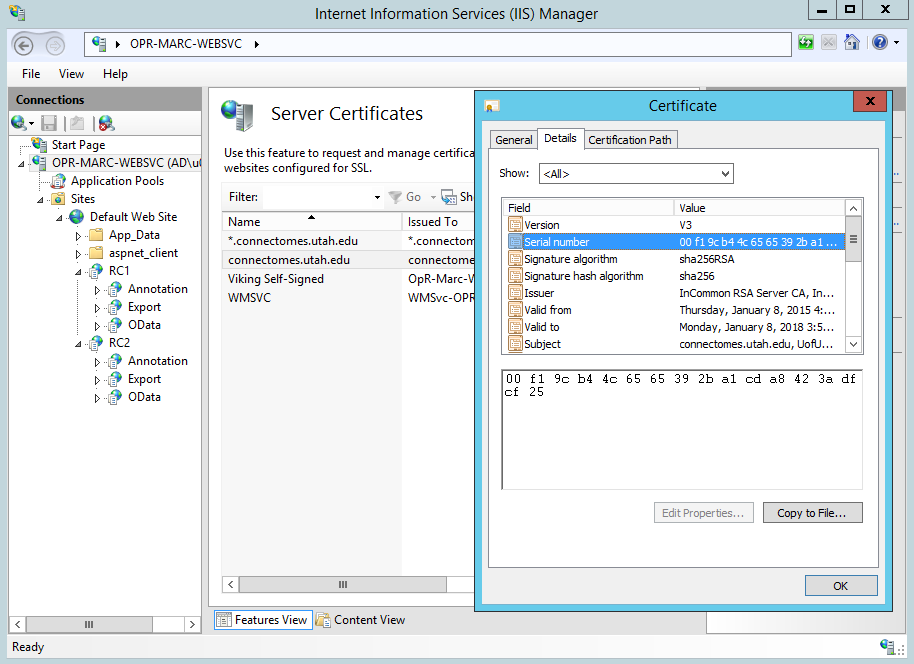
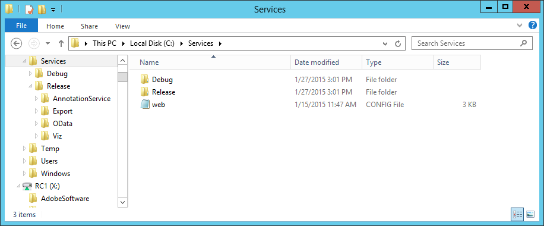

####################
IIS legacy services
####################

The WCF annotation service, OData, DataExport and the tile folders still run on Windows IIS. In the
stack registry this is ``viking-iis`` (``Engine = 'iis'``), deployed by
``deploy/Deploy-VikingIis.ps1``. Clients reach it as ``VIKING_HOSTNAME_WEBSVC``
(``websvc.<domain>``): the proxy passes port 443 through to ``VIKING_IIS_HOST:443``, so IIS presents
the shared certificate itself.

Deploy script
=============

``deploy/Deploy-VikingIis.ps1 -Action <...>`` wraps the existing scripts with paths from parameters or
from ``Run/viking-iis/viking-iis.run.env`` (``deploy/examples/example.viking-iis.run.env``):

================  ==========================================================  ====================
Action            What it does                                                Where it runs
================  ==========================================================  ====================
``Annotation``    ``Servers/AnnotationService/DeployProduction.cmd``:         build machine
                  robocopy the WCF ``bin`` to
                  ``<VIKING_IIS_DEPLOY_ROOT>\Release\AnnotationService\bin``
                  (``web.config`` kept). The default action.
``Export``        ``Scripts/Deploy-ExportApplication.ps1`` for each volume    IIS host, admin
                  in ``VIKING_IIS_VOLUMES``, URL base
                  ``https://<VIKING_HOSTNAME_WEBSVC>/``.
``ConfigureIIS``  ``Scripts/ConfigureIIS.ps1`` (recreates the annotation,     IIS host, admin
                  odata and dataexport pools and applications).
``Certificate``   ``deploy/Install-IisCertificate.ps1`` with                  IIS host, admin
                  ``VIKING_IIS_PFX_PATH``.
``Status``        Prints the resolved settings.                               anywhere
================  ==========================================================  ====================

The wrapped scripts keep their behaviour; their paths are now parameters whose defaults are the old
values (``DeployProduction.cmd [SourceBin] [TargetBin]``, ``ConfigureIIS.ps1 -WebRoot -SiteName``).
``-WhatIf`` works on every action.

Certificate
===========

Copy ``cert.pfx`` from the web host's ``<root>/Certs/<TLS_CERT_NAME>/`` after each renewal and run::

   .\deploy\Install-IisCertificate.ps1 -PfxPath C:\certs\viking\cert.pfx -HostHeader websvc.connectomes.pitt.edu

See :doc:`tls` for the binding rules and the AnnotationService ``serviceCertificate`` serial number.

First-time IIS setup
====================

(From the former *Web Services* developer page.)

IIS must be installed with WCF and .NET 4.x support (:download:`installed roles
<../server/IIS/IISServerConfig.png>`). The AnnotationService refers to its certificate by serial number:

In the AnnotationService ``web.config`` set the ``serviceCertificate`` ``findValue`` to that serial
number::

   <serviceCertificate findValue="<serial>" storeLocation="LocalMachine" x509FindType="FindBySerialNumber"/>

This is only needed when you write to your own annotation service; OData and Export can point at an
existing one.

Publish to the deployment directory:

* **Annotation Service**, built as both Release and Debug (``-Action Annotation`` copies Release).
* **ConnectomeOpenData**, Production and Test configurations.
* **DataExport**, Production and Test configurations.

All volumes share one copy of the binaries: the deployment directory lives outside IIS and every
volume's applications point at it, so updating it upgrades every volume.

Per volume
----------

#. Create a folder for the volume under the site root and copy the default ``web.config`` from the
   deployment directory into it (for example ``C:\inetpub\wwwroot\RC1\web.config``).

   .. image:: ../server/IIS/WebServiceFolders.png

#. Create a .NET 4 application pool for the volume. When the database is on another machine, run it
   as an Active Directory account with database access. A separate pool with write permission is
   used for the annotation service in production.

   .. image:: ../server/IIS/IISVolumeApplicationPoolConfig.png

#. Convert the folder to an application on that pool. Add the connection strings
   *VikingApplicationServices* (ASP.NET roles/membership database) and *VikingDatabaseConnection*
   (annotation database).
#. Add one application per service: **Annotation**, **OData**, **Export** (append ``Test`` for the
   debug binaries, e.g. *ODataTest*). ``-Action Export`` creates the Export application.

   .. image:: ../server/IIS/IISCreateApplication.png

#. Application settings at the volume level (inherited by the child applications):

   .. image:: ../server/IIS/IISAppSettings.png

   **Shared**
      :DatabaseConnectionString: Annotation and OData connection string name, *VikingDatabaseConnection* by default.
   **Export**
      :DefaultLocationColorMapsPath, DefaultStructureColorsPath, DefaultStructureTypeColorsPath: default color mapping files.
      :EndpointURL: annotation service used by the exporter; **EndpointUsername** / **EndpointPassword**: a read-only account (*anonymous*).
      :(X/Y/Z)ScaleUnits, (X/Y/Z)ScaleValue: pixel scale and its unit (default *nm*).

Plain HTTP
==========

If Viking clients still call ``http://websvc.<domain>/...``, set ``VIKING_HTTP_UPSTREAM_WEBSVC`` in the
proxy run env (``<iis host>:80``) so port 80 is proxied instead of redirected (:doc:`proxy`).
